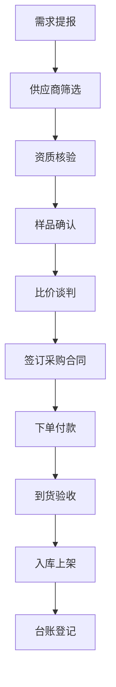
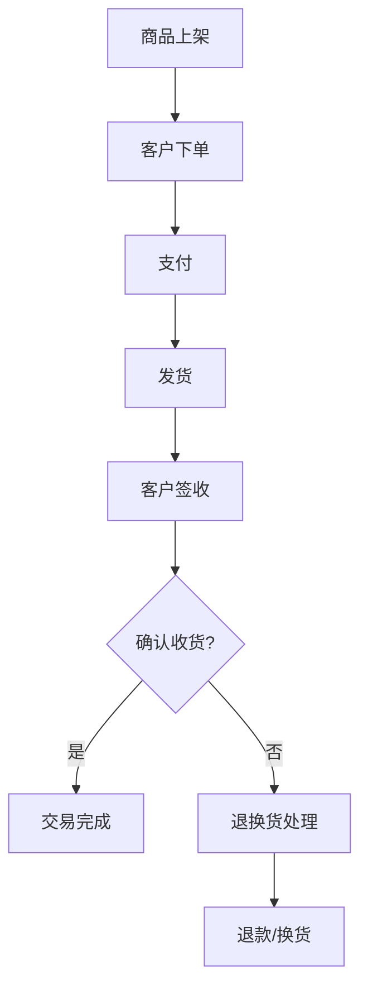

# 汽车用品交易操作手册

- 版本：V1.0
- 编制日期：2026-11-17
- 适用范围：汽车用品（装饰、养护、电子、改装、安全等）的批发、零售、电商交易、采购验收、质量管控与售后全流程
- 配套文档：《汽车维修美容服务操作手册》（同层级 auto-beauty-docs 目录）
- 使用说明：本手册为通用作业规范，具体产品认证要求、交易条款以国家法规和本公司制度为准

---

## 1. 目的

规范汽车用品交易各环节的操作标准、质量要求和合规边界，做到：

1. 用品分类清晰、采购渠道正规、产品质量可追溯；
2. 强制认证（CCC）产品不遗漏，进货查验义务履行到位；
3. 线上线下交易流程规范，退换货按法规执行；
4. 不销售假冒伪劣、侵权、三无产品，规避监管处罚；
5. 客户售后响应及时，投诉闭环处理。

---

## 2. 汽车用品分类

### 2.1 按用途分类

| 大类 | 子类 | 典型产品 |
|---|---|---|
| 装饰用品 | 内饰装饰 | 座垫、脚垫、方向盘套、挂件、香水、摆件 |
|  | 外饰装饰 | 车贴、晴雨挡、车窗饰条、挡泥板、轮眉 |
| 养护用品 | 清洗 | 洗车液、轮毂清洗剂、玻璃水、内饰清洁剂 |
|  | 护理 | 车蜡、镀晶液、皮革护理乳、轮胎上光剂 |
|  | 油液 | 机油、刹车油、防冻液、变速箱油、车用尿素 |
| 电子电器 | 影音导航 | 行车记录仪、导航、车载音响、倒车雷达 |
|  | 安全电子 | 胎压监测、电子狗、防盗器、GPS 定位 |
|  | 充电 | 车载充电器、逆变器、新能源充电枪 |
| 安全用品 | 被动安全 | 儿童安全座椅、安全带、安全锤、灭火器 |
|  | 应急 | 三角警示牌、反光背心、搭电线、拖车绳 |
| 改装用品 | 外观改装 | 包围、尾翼、改色膜、拉花 |
|  | 性能改装 | 轮毂、刹车、避震、排气 |
| 膜类产品 | 玻璃膜 | 太阳膜、隔热膜、防弹膜 |
|  | 漆面保护膜 | 隐形车衣、改色膜 |
| 功能用品 | 存储 | 后备箱垫、收纳箱、车顶行李箱 |
|  | 舒适 | 头枕、腰靠、遮阳挡、车载冰箱 |

### 2.2 按认证要求分类

| 类别 | 认证要求 | 说明 |
|---|---|---|
| 强制认证（CCC） | 必须取得 CCC 认证 | 汽车安全带、汽车安全玻璃、机动车外部照明及光信号装置、机动车辆间接视野装置（后视镜）、汽车座椅及座椅头枕、汽车内饰件、机动车喇叭、机动车回复反射器等 |
| 自愿性认证 | 鼓励但非强制 | 部分电子产品、养护用品 |
| 无需认证 | 一般用品 | 普通装饰件、收纳用品等 |

依据：国家认证认可监督管理委员会《强制性产品认证实施规则》（车辆及安全附件类）。

---

## 3. 交易渠道

### 3.1 渠道类型

| 渠道 | 特点 | 适用场景 |
|---|---|---|
| 厂家直营 | 一手货源、正品保障、价格优势 | 大批量采购、品牌代理 |
| 汽配城/批发市场 | 品类齐全、现货充足、可验货 | 中小批发、零售补货 |
| B2B 电商平台（1688 等） | 价格透明、选择多、物流方便 | 线上批发、比价采购 |
| 品牌代理商/经销商 | 区域授权、售后保障 | 正品品牌用品采购 |
| O2O 平台 | 线上选品+线下安装 | 面向终端车主 |
| 零售门店 | 体验好、即时交付 | 终端零售 |

### 3.2 渠道选择原则

1. **正品优先**：选择厂家授权、品牌代理渠道，规避假冒风险；
2. **资质核验**：供应商需提供营业执照、品牌授权书、产品检测报告；
3. **比价择优**：同品多渠道比价，综合考虑价格、运费、账期、售后；
4. **稳定供应**：核心用品选择 2 家以上供应商，避免断货；
5. **账期管理**：新供应商现款现货，合作稳定后可申请账期。

### 3.3 线上渠道趋势

- 线上渠道占比已达约 40%；
- "直播间种草、线上下单、门店安装"成为主流消费路径；
- 一线城市偏好智能化高端品牌，二三线城市看重性价比。

---

## 4. 采购与进货查验

### 4.1 采购流程

### 4.2 进货查验义务

依据《中华人民共和国产品质量法》和《消费者权益保护法》，经营者应当履行进货查验义务：

1. **查验供应商资质**：营业执照、生产许可证（如适用）；
2. **查验产品合格证明**：产品合格证、检测报告；
3. **查验认证标志**：CCC 认证产品须有 CCC 标志和证书编号；
4. **查验产品标识**：产品名称、厂名厂址、规格型号、生产日期、保质期、执行标准；
5. **留存凭证**：采购合同、发票、送货单、检测报告等，留存备查。

不履行进货查验义务销售侵权产品的，将面临没收、罚款等行政处罚。

### 4.3 到货验收要点

| 验收项 | 内容 |
|---|---|
| 数量 | 核对送货单与实际数量 |
| 外观 | 包装完好、无破损、无污染 |
| 标识 | 品名、规格、厂家、日期、CCC 标志齐全 |
| 质量 | 抽检产品外观、功能，必要时送检 |
| 有效期 | 油液、化工类用品在保质期内 |
| 单证 | 发票、合格证、检测报告齐全 |

验收不合格的，拒收并联系供应商处理。

---

## 5. 产品质量与认证管理

### 5.1 CCC 强制认证管理

涉及汽车安全的用品必须取得 CCC 认证后方可销售：

| 产品 | 认证规则 | 要点 |
|---|---|---|
| 汽车安全带 | CNCA-C11-06 | 必须有 CCC 标志 |
| 汽车安全玻璃 | CNCA-C11-02 | 钢化玻璃、夹层玻璃 |
| 机动车外部照明及光信号装置 | CNCA-C11-03 | 前照灯、转向灯、制动灯等 |
| 机动车辆间接视野装置 | CNCA-C11-04 | 后视镜 |
| 汽车座椅及座椅头枕 | CNCA-C11-05 | 汽车座椅 |
| 汽车内饰件 | CNCA-C11-09：2014 | 阻燃性能要求 |
| 机动车喇叭 | CNCA-C11-07 | 声级要求 |
| 机动车回复反射器 | CNCA-C11-08 | 反光性能 |

管理要求：
1. 采购 CCC 产品须核验 CCC 证书有效性（可在认监委官网查询）；
2. 产品本体或包装上须有 CCC 标志；
3. 不得销售未获认证、认证过期、证书暂停/撤销的产品；
4. 不得伪造、冒用 CCC 标志。

### 5.2 产品标识要求

汽车用品（特别是化工类、油液类、电子类）应有清晰中文标识，包含：

1. 产品名称、规格型号；
2. 生产者名称、地址；
3. 执行标准号；
4. 生产日期或批号、保质期；
5. 产品合格证；
6. 使用说明、注意事项；
7. CCC 认证标志（如适用）。

标识标注不完整、不清晰，厂名厂址、合格证明不规范的，属于违规。

### 5.3 重点监管产品

市场监管总局重点抽查的汽车相关产品包括：

| 产品 | 常见不合格项 |
|---|---|
| 机动车辆制动液 | 平衡回流沸点、湿沸点、运动黏度、低温流动性 |
| 车用尿素水溶液 | 尿素含量、杂质、折光率 |
| 发动机润滑油 | 运动黏度、倾点、闪点、低温泵送性 |
| 汽车轮胎 | 强度、耐磨、标志 |
| 汽车蓄电池 | 容量、低温启动、标志 |
| 儿童安全座椅 | 阻燃、动态试验、标识 |

这些产品属于高风险品类，采购时必须索要检测报告。

### 5.4 假冒伪劣识别

| 识别维度 | 正品特征 | 假冒特征 |
|---|---|---|
| 包装 | 印刷清晰、材质好、封口规整 | 印刷模糊、材质差、封口粗糙 |
| 标识 | 厂名厂址齐全、CCC 标志清晰 | 标识不全、CCC 标志模糊或伪造 |
| 价格 | 价格在合理区间 | 远低于市场价 |
| 渠道 | 品牌授权、正规代理 | 不明来源、无授权 |
| 防伪 | 有防伪码可查询 | 无防伪或防伪码无法验证 |

---

## 6. 销售与交易流程

### 6.1 线下零售流程

1. **客户接待**：了解需求，推荐合适产品；
2. **产品展示**：实物展示、功能演示；
3. **报价**：明码标价，说明质保与安装服务；
4. **成交**：确认型号、数量、价格，开具销售单；
5. **收款开票**：收取货款，开具发票或收据；
6. **交付/安装**：交付产品或提供安装服务；
7. **售后告知**：质保范围、退换货政策。

### 6.2 电商交易流程

### 6.3 商品上架规范

1. 商品标题、描述真实准确，不夸大宣传；
2. 图片为实物拍摄，不使用虚假效果图；
3. 价格明码标价，不虚假标价；
4. 规格参数、适用车型、质保期限明确；
5. CCC 产品须展示 CCC 证书编号；
6. 不适用无理由退货的商品须显著标注。

---

## 7. 退换货与售后

### 7.1 七日无理由退货

依据《网络购买商品七日无理由退货暂行办法》：

1. 网络购物消费者有权自收到商品之日起 7 日内退货，无需说明理由；
2. 消费者退货时应将商品本身、配件及赠品一并退回；
3. 赠品不能退回的，经营者可要求按标明的赠品价格支付价款；
4. 商品完好的，经营者应在收到退回商品之日起 7 日内返还价款；
5. 退货运费由消费者承担，另有约定的从约定。

### 7.2 不适用无理由退货的商品

1. 消费者定作的（如定制脚垫、定制座套）；
2. 鲜活易腐的；
3. 在线下载或者消费者拆封的音像制品、计算机软件等数字化商品；
4. 交付的报纸、期刊；
5. 拆封后易影响人身安全或生命健康的商品，或拆封后易导致商品品质发生改变的商品；
6. 一经激活或者试用后价值贬损较大的商品；
7. 销售时已明示的临近保质期的商品、有瑕疵的商品。

### 7.3 质量问题退换货

1. 商品存在质量问题的，消费者可在质保期内要求修理、更换、退货；
2. 京东等平台汽车用品自营通常支持 7 日退货、15 日换货；
3. 因质量问题产生的退货运费由经营者承担；
4. 安装类产品拆卸费由消费者承担（无约定时），质量问题可协商。

### 7.4 汽车用品售后时效参考

| 场景 | 时限 | 责任方 |
|---|---|---|
| 无理由退货 | 签收后 7 日内 | 消费者承担运费 |
| 质量问题退货 | 质保期内 | 经营者承担运费 |
| 换货 | 签收后 15 日内（平台规则） | 视原因而定 |
| 质保维修 | 产品质保期内 | 经营者/厂家 |

### 7.5 售后处理流程

1. 受理售后申请，了解问题；
2. 核实订单、产品、问题描述；
3. 判定责任：质量问题/人为损坏/不适用；
4. 提供方案：退货/换货/维修/补偿；
5. 执行处理，跟踪结果；
6. 回访确认，记录归档。

---

## 8. 价格与合同管理

### 8.1 明码标价

1. 所有销售商品明码标价，注明品名、规格、价格；
2. 不得虚假标价、低价诱骗高价结算；
3. 促销活动价格真实，不得虚构原价；
4. 价格变动及时更新。

### 8.2 采购合同必备条款

1. 供需双方信息（名称、地址、联系方式）；
2. 产品信息（品名、规格、型号、数量、单价、金额）；
3. 质量标准（执行标准、认证要求、验收标准）；
4. 交货方式、时间、地点；
5. 付款方式、账期；
6. 包装要求；
7. 验收标准与异议期限；
8. 违约责任；
9. 售后与质保；
10. 争议解决方式。

### 8.3 销售合同/订单必备信息

1. 买卖双方信息；
2. 产品信息（品名、规格、数量、价格）；
3. 交付方式与时间；
4. 质保与售后条款；
5. 付款方式；
6. 退换货约定。

---

## 9. 仓储与库存管理

### 9.1 仓储要求

| 产品类型 | 存储条件 |
|---|---|
| 油液类（机油、刹车油） | 阴凉干燥、远离火源、避光、温度 5-35℃ |
| 化工类（清洗剂、镀晶液） | 通风、远离火源、避免暴晒 |
| 电子类（记录仪、充电器） | 干燥、防潮、防静电 |
| 膜类（太阳膜、车衣） | 常温、避光、竖放、避免折压 |
| 橡胶/塑料件 | 阴凉、避免臭氧、远离热源 |

### 9.2 库存管理

1. 建立库存台账，记录品名、规格、数量、批次、有效期；
2. 先进先出，避免过期；
3. 定期盘点，账实相符；
4. 滞销品及时促销或退货；
5. 危险品单独存放，符合消防要求。

---

## 10. 合规红线

以下行为严禁触碰：

1. **销售未获 CCC 认证产品**：涉及安全的用品未取得 CCC 认证即销售；
2. **销售假冒伪劣产品**：假冒品牌、以次充好、以不合格冒充合格；
3. **销售"三无"产品**：无厂名厂址、无合格证、无执行标准；
4. **虚假宣传**：夸大产品功能、伪造认证标志、虚构原价；
5. **不履行进货查验义务**：未查验供应商资质和产品合格证明；
6. **价格欺诈**：虚假标价、低价诱骗、价外加价；
7. **拒绝无理由退货**：网络销售不依法执行 7 日无理由退货；
8. **销售侵权产品**：侵犯注册商标专用权；
9. **违规存储危化品**：易燃易爆品存储不符合消防要求。

### 10.1 法律责任

| 违法行为 | 法律依据 | 处罚 |
|---|---|---|
| 销售假冒伪劣 | 《产品质量法》第 50 条 | 没收违法所得，罚款货值 50%-3 倍 |
| 销售侵权商品 | 《商标法》第 60 条 | 没收侵权商品，罚款非法经营额 5 倍以下 |
| 未履行进货查验 | 《产品质量法》第 33 条 | 责令改正，没收违法所得 |
| 价格欺诈 | 《价格法》第 40 条 | 没收违法所得，罚款 5 倍以下 |
| 拒绝无理由退货 | 《消费者权益保护法》第 56 条 | 警告、没收违法所得、罚款 |

---

## 11. 消费者权益与投诉处理

### 11.1 消费者权益

1. **知情权**：了解商品真实情况（认证、产地、质量、价格）；
2. **选择权**：自主选择商品和服务；
3. **公平交易权**：质量保障、价格合理、计量正确；
4. **求偿权**：因商品质量受损可要求赔偿；
5. **监督权**：对商品和服务进行监督。

### 11.2 投诉处理

1. **受理渠道**：到店、电话、电商平台、12315、消费者协会；
2. **响应时效**：及时响应，不推诿、不拖延；
3. **处理原则**：事实为依据，依法依规，协商优先；
4. **升级路径**：一般投诉由门店处理，重大投诉（群体性、媒体曝光）升级管理层；
5. **记录归档**：所有投诉处理记录留存，定期分析改进。

### 11.3 常见投诉与处理

| 投诉类型 | 处理方式 |
|---|---|
| 产品质量问题 | 核实后按质保政策退换或维修 |
| 货不对版 | 核实订单，退换或补差 |
| 价格争议 | 出示标价和订单，核对确认 |
| 安装服务问题 | 核实施工情况，免费返工或补偿 |
| 假冒伪劣质疑 | 提供正品证明，或送检鉴定 |

---

## 12. 常用法规与标准

| 法规/标准 | 要点 |
|---|---|
| 《中华人民共和国产品质量法》 | 产品质量责任、进货查验、假冒伪劣处罚 |
| 《中华人民共和国消费者权益保护法》 | 消费者权益、无理由退货、欺诈赔偿 |
| 《网络购买商品七日无理由退货暂行办法》 | 网购 7 日无理由退货规则 |
| 《中华人民共和国商标法》 | 注册商标保护、侵权处罚 |
| 《强制性产品认证管理规定》 | CCC 认证产品范围与要求 |
| 《强制性产品认证实施规则 汽车》CNCA-C11-01 | 整车及部件认证要求 |
| 《强制性产品认证实施规则 汽车内饰件》CNCA-C11-09 | 内饰件阻燃认证 |
| 《机动车运行安全技术条件》GB 7258 | 车辆安全技术要求 |
| 《中华人民共和国价格法》 | 明码标价、禁止价格欺诈 |
| 《危险化学品安全管理条例》 | 危化品采购、存储、经营 |

---

## 13. 附：采购与销售速查表

### 13.1 采购验收清单

| 检查项 | 是否合格 |
|---|---|
| 供应商营业执照在有效期内 |  |
| 品牌授权书（如适用） |  |
| 产品合格证齐全 |  |
| 产品检测报告齐全 |  |
| CCC 认证产品有 CCC 标志和有效证书 |  |
| 产品标识（厂名、厂址、规格、日期、标准）齐全 |  |
| 包装完好无破损 |  |
| 数量与送货单一致 |  |
| 油液/化工品在保质期内 |  |

### 13.2 上架销售检查清单

| 检查项 | 是否合格 |
|---|---|
| 商品明码标价 |  |
| 商品描述真实准确 |  |
| CCC 产品展示证书编号 |  |
| 不适用无理由退货商品显著标注 |  |
| 规格参数、适用车型明确 |  |
| 质保期限说明 |  |
| 促销价格真实有效 |  |

---

*本手册由信息整理编制，具体产品认证要求、交易条款以国家法规和本公司制度为准。*
