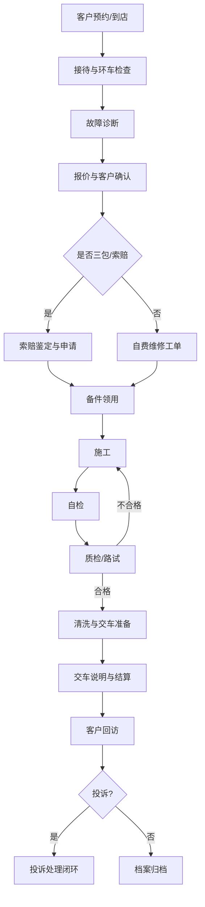
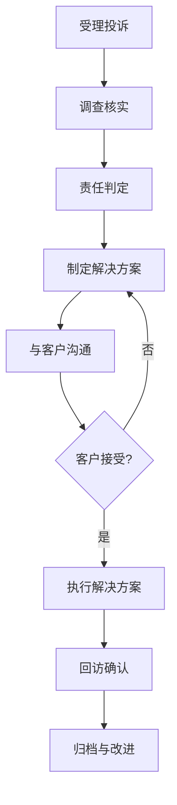

# 汽车售后服务操作手册

- 版本：V1.0
- 编制日期：2026-11-17
- 适用范围：乘用车（燃油车、新能源车）授权服务中心/4S 店的保养、维修、三包索赔、备件、召回、投诉处理与客户回访全流程
- 配套文档：《汽车销售操作手册》（同层级 auto-sales-docs 目录）
- 使用说明：本手册为通用作业规范，具体车型保养周期、备件目录、索赔规则以厂家服务手册和本公司制度为准

---

## 1. 目的

统一售后服务各环节的操作标准、信息口径和合规要求，做到：

1. 客户接待、诊断、报价、施工、质检、交车各环节有标准动作；
2. 所有维修项目、备件使用、费用明细可追溯；
3. 三包期内质量问题按规索赔，不推诿、不拖延；
4. 缺陷产品召回及时通知、如实记录、闭环管理；
5. 客户投诉 7 个工作日内响应，重大投诉升级处理。

---

## 2. 岗位与职责

| 岗位 | 主要职责 | 关键产出 |
|---|---|---|
| 服务顾问（SA） | 预约、接待、环车检查、诊断、报价、工单开立、交车说明 | 工单、报价单、交付验收单 |
| 维修技师 | 按工单施工、故障诊断、索赔件鉴定、自检 | 维修记录、自检表 |
| 质检员 | 维修质量终检、路试、工单审核 | 质检报告 |
| 备件管理员 | 备件采购、入库、出库、库存盘点、追溯记录 | 备件台账、出入库单 |
| 索赔员 | 三包索赔申请、故障件寄送、索赔结算 | 索赔申请单、结算记录 |
| 客户关系专员（CRC） | 回访、投诉受理、满意度调查、客户档案维护 | 回访记录、投诉处理单 |
| 服务经理 | 服务排班、重大投诉处理、服务质量管控 | 服务日报、投诉处理意见 |

原则：维修与质检不得由同一人操作；索赔鉴定与费用结算须分离；所有免费项目（索赔、召回）须有厂家授权或工单记录。

---

## 3. 售后服务全流程总览

| 阶段 | 关键动作 | 输出 | 常见阻断 |
|---|---|---|---|
| 接待 | 预约登记、环车检查、确认诉求 | 客户登记、环车检查表 | 客户描述不清、无预约排队 |
| 诊断 | 电脑检测、路试、人工排查 | 诊断报告 | 间歇性故障难复现 |
| 报价 | 工时费、备件费、预估工期 | 报价单 | 客户对价格/工期异议 |
| 施工 | 按工单作业、索赔件标识 | 维修记录 | 备件缺货、二次故障 |
| 质检 | 终检、路试、功能确认 | 质检报告 | 质检不通过返工 |
| 交车 | 项目说明、旧件展示、结算 | 交付验收单 | 客户对维修结果不满 |

---

## 4. 预约与接待

### 4.1 预约管理

1. 预约渠道：电话、APP、微信、官网；
2. 预约信息：车牌、车型、里程、服务项目、期望时间、联系方式；
3. 提前 1 天电话确认，告知预计等待时间和需携带资料（行驶证、保养手册）；
4. 预约客户优先接待，减少等待。

### 4.2 接待标准

1. 客户到店 3 分钟内主动迎接，自我介绍；
2. 安装方向盘套、座椅套、脚垫（三件套）；
3. 环车检查，记录外观损伤、里程、油量、随车物品；
4. 倾听客户诉求，复述确认，避免主观判断；
5. 对于投诉客户，先安抚情绪，再了解事实。

### 4.3 环车检查要点

| 检查项 | 内容 |
|---|---|
| 外观 | 漆面划痕、凹陷、玻璃裂纹、轮胎状态 |
| 内饰 | 座椅、中控、仪表盘、随车物品 |
| 随车 | 备胎、工具、三角牌、反光背心、充电枪 |
| 仪表 | 里程数、油量/电量、故障灯 |

检查结果由客户签字确认，避免交付时纠纷。

---

## 5. 故障诊断

### 5.1 诊断流程

1. 问诊：了解故障现象、发生条件、频率；
2. 电脑检测：用厂家专用诊断仪读取故障码、数据流；
3. 路试：复现故障，记录工况；
4. 人工排查：结合经验检查相关部件；
5. 出具诊断报告，明确故障原因与维修方案。

### 5.2 诊断原则

1. 先外后内、先简后繁、先代码后经验；
2. 间歇性故障需留存故障码截图、视频证据；
3. 无法确诊时，按厂家技术通报（TSB）排查；
4. 诊断结果须向客户解释清楚，不夸大、不隐瞒。

---

## 6. 维修保养作业

### 6.1 保养周期参考

以下为通用周期，具体以厂家保养手册为准，遵循"先到为准"（里程或时间）原则。

| 保养项目 | 周期 | 备注 |
|---|---|---|
| 发动机机油+机滤 | 矿物油 5000km/6 个月；半合成 7500km/9 个月；全合成 10000km/12 个月 | 涡轮增压车型建议全合成油，周期可适当缩短 |
| 空气滤芯 | 10000-15000km/1 年 | 灰尘大地区提前更换 |
| 空调滤芯 | 10000-15000km/1 年 | 有异味或雾霾频繁使用时提前 |
| 燃油滤芯 | 30000-60000km | 外置式约 3 万 km，内置式约 6 万 km |
| 火花塞 | 普通 30000km；铂金 60000km；铱金 100000km | 按厂家手册 |
| 刹车片 | 前片 30000-50000km；后片 60000-80000km | 磨损至 3mm 更换 |
| 刹车油 | 2 年/40000km | 含水率超过 3% 必须更换 |
| 变速箱油 | 手动 60000km；自动 60000-80000km | CVT 按厂家要求 |
| 防冻液 | 2 年/40000km | 长效防冻液可延长 |
| 轮胎 | 5 年/60000-80000km | 花纹深度低于 1.6mm 必须更换 |
| 蓄电池 | 3-5 年 | 启动电压低于 12V 需关注 |

### 6.2 新能源车保养专项

| 项目 | 周期 | 内容 |
|---|---|---|
| 动力电池检查 | 每 10000km/6 个月 | 电池健康度（SOH）、绝缘检测、压差 |
| 电机与电控 | 每 20000km | 电机异响、电控散热、线束 |
| 充电系统 | 每 10000km | 充电口、充电枪、快充/慢充功能 |
| 减速器油 | 每 40000-60000km | 按厂家要求 |
| 高压安全检查 | 每次保养 | 高压部件绝缘、防护、接地点 |

### 6.3 维修作业规范

1. 严格按工单施工，不擅自增减项目；
2. 发现额外故障，先报服务顾问，由客户确认后追加工单；
3. 维修过程发现索赔件，按索赔流程标识、单独存放；
4. 换下的旧件按规定交还客户或按客户要求处理；
5. 施工完成后技师自检，签字确认。

---

## 7. 备件管理

### 7.1 备件分类

| 类别 | 说明 |
|---|---|
| 原厂件（OEM） | 厂家供应，质量等同装车件，享受原厂质保 |
| 同质配件 | 质量等同或高于装车件标准，可用于维修，须明示客户 |
| 副厂件 | 非原厂、非同质的第三方配件，一般不建议使用 |
| 假冒伪劣件 | 严禁使用，违反《机动车维修管理规定》 |

依据：《机动车维修管理规定》第三十条，机动车维修配件实行追溯制度，不得使用假冒伪劣配件。

### 7.2 备件追溯要求

1. 记录配件采购、使用信息；
2. 查验产品合格证等证明；
3. 留存配件来源凭证；
4. 建立出入库台账，做到来源可查、去向可追。

### 7.3 旧件处理

1. 维修换下的配件、总成应当交托修方自行处理；
2. 索赔件按厂家要求单独存放、寄回，不得私自处理；
3. 客户不要的旧件，按环保规定处置，留存记录。

---

## 8. 质量控制与交车

### 8.1 三级质检

| 级别 | 执行人 | 内容 |
|---|---|---|
| 自检 | 维修技师 | 按工单逐项确认，签字 |
| 互检 | 班组/组长 | 关键工序复核 |
| 终检 | 质检员 | 全面检查、路试、功能测试，签字 |

未经终检合格的车辆不得交付客户。

### 8.2 交车标准

1. 车辆清洁（外观清洗、内饰吸尘）；
2. 三件套拆除；
3. 旧件展示（客户要求时）；
4. 维修项目逐项说明，展示更换的备件；
5. 费用明细说明（工时、备件、辅料）；
6. 质保说明（维修项目质保期）；
7. 下次保养提醒；
8. 客户签字确认《交付验收单》。

### 8.3 维修质保

1. 机动车维修实行竣工出厂质量保证期制度；
2. 汽车和危险货物运输车辆整车修理或总成修理质量保证期为车辆行驶 20000 公里或者 100 日；
3. 二级维护质量保证期为车辆行驶 5000 公里或者 30 日；
4. 一级维护、小修及专项修理质量保证期为车辆行驶 2000 公里或者 10 日；
5. 以先到者为准，自竣工出厂之日起计算。

---

## 9. 三包与保修索赔

### 9.1 三包期限

依据《家用汽车产品修理更换退货责任规定》（国家市场监督管理总局令第 43 号，2022 年 1 月 1 日施行）：

| 项目 | 期限 | 计算起点 |
|---|---|---|
| 三包有效期 | 不低于 2 年或 50000 公里 | 购车发票开具之日，发票日期与交付日期不一致的，自交付之日起 |
| 包修期 | 不低于 3 年或 60000 公里 | 同上 |
| 易损件质保 | 按厂家规定，一般不低于 6 个月或 10000 公里 | 同上 |

### 9.2 包修范围

在包修期内，家用汽车产品出现产品质量问题，消费者凭三包凭证由修理者免费修理（包括工时费和材料费）。

### 9.3 退换车条件

#### 更换或退货（三包有效期内）

家用汽车产品自销售者开具购车发票（或者交付产品）之日起 60 日内或者行驶里程 3000 公里之内（以先到者为准），出现下列情况之一，消费者选择更换或退货的，销售者应当负责更换或退货：

1. 转向系统失效；
2. 制动系统失效；
3. 车身开裂；
4. 燃油泄漏；
5. 因严重安全性能故障累计进行 2 次修理，严重安全性能故障仍未排除或者又出现新的严重安全性能故障的；
6. 发动机、变速器累计更换 2 次后，或者发动机、变速器的同一主要零件因其质量问题，累计更换 2 次后，仍不能正常使用的；
7. 转向系统、制动系统、悬架系统、前/后桥、车身的同一主要零件因其质量问题，累计更换 2 次后，仍不能正常使用的。

#### 其他退换情形

在三包有效期内，因产品质量问题修理时间累计超过 30 日的，或者因同一产品质量问题累计修理超过 4 次的，消费者可以凭三包凭证、购车发票，由销售者负责更换。

### 9.4 三包索赔流程

1. 车辆进站报修，服务顾问接待、鉴定、登记；
2. 确认车辆在三包/包修期内，故障属于质量问题（非人为、非事故、非保养不当）；
3. 技师按厂家保修作业规范施工，索赔员录入索赔信息、打印条码、粘贴标识；
4. 故障件按厂家要求包装、寄回，留存物流凭证；
5. 厂家索赔部门审核，符合条件的结算索赔款；
6. 索赔结果通知客户，免费维修项目不向客户收费。

### 9.5 不属三包范围

1. 易损耗零部件超出其质量保证期；
2. 消费者未按使用说明书要求正确使用、维护、修理产品而造成损坏；
3. 消费者自行改装、调整、拆卸造成损坏；
4. 发生产品质量问题，消费者自行处置不当造成损坏；
5. 因不可抗力造成损坏；
6. 不能提供有效发票和三包凭证。

---

## 10. 汽车召回

### 10.1 召回依据

依据《缺陷汽车产品召回管理条例》及其实施办法，生产者确认汽车产品存在缺陷的，应当立即停止生产、销售、进口缺陷汽车产品，并实施召回。

### 10.2 召回流程

1. 生产者获知可能存在缺陷，立即组织调查分析，向市场监管总局报告；
2. 确认存在缺陷，制定召回计划并备案；
3. 生产者以公众知晓方式发布信息，告知车主：缺陷内容、应急处置方法、消除缺陷措施；
4. 服务中心接收召回通知，梳理涉及车辆，主动联系车主预约到店；
5. 到店后按召回方案免费维修/更换，记录召回完成信息；
6. 召回完成率、进度按要求上报。

### 10.3 服务中心职责

1. 建立召回车辆台账，记录通知、预约、到店、完成情况；
2. 召回维修不得向客户收取任何费用；
3. 优先安排召回车辆，缩短等待时间；
4. 召回维修记录留存不少于 10 年。

---

## 11. 客户投诉处理

### 11.1 投诉受理

1. 渠道：电话、到店、APP、厂家客服、12315、媒体；
2. 登记：投诉人、车牌号、联系方式、投诉事项、诉求、发生时间；
3. 响应：自收到投诉之日起 7 个工作日内通知客户处理进展；
4. 重大投诉（涉及安全、群体性、媒体曝光）立即升级服务经理。

### 11.2 投诉处理流程

### 11.3 处理原则

1. **先处理情绪，再处理事情**：倾听、共情、不推诿；
2. **事实为依据**：调阅工单、维修记录、监控，厘清责任；
3. **及时响应**：15 分钟内专人对接，2 小时内初步方案，24 小时内闭环（视投诉等级）；
4. **闭环管理**：处理结果回访确认，不满意的升级处理；
5. **根源改进**：分析投诉根因，制定预防措施，避免重复发生。

### 11.4 投诉升级路径

| 等级 | 触发条件 | 处理人 |
|---|---|---|
| 一般 | 服务态度、轻微纠纷 | 服务顾问/服务经理 |
| 重大 | 质量争议、金额较大、重复投诉 | 服务经理/总经理 |
| 紧急 | 安全事故、群体性、媒体/监管介入 | 总经理/厂家客服 |

### 11.5 客户维权渠道告知

如协商无果，可告知客户合法维权途径：

1. 拨打 12315 热线，向市场监管部门投诉；
2. 向当地消费者协会投诉；
3. 向厂家客服中心投诉；
4. 涉及批量质量问题，向国家市场监管总局缺陷产品管理中心报告；
5. 依法申请仲裁或提起诉讼。

---

## 12. 回访与满意度管理

### 12.1 回访节点

| 节点 | 时间 | 内容 |
|---|---|---|
| 维修后 24 小时 | 交车后 1 天内 | 维修质量、服务态度、是否满意 |
| 维修后 3 天 | 交车后 3 天 | 故障是否复发、使用体验 |
| 保养提醒 | 下次保养前 1 周 | 保养预约提醒 |

### 12.2 满意度分级与响应

| 评分 | 等级 | 响应 |
|---|---|---|
| 9-10 分 | 推荐者 | 感谢，邀请转介绍 |
| 7-8 分 | 中立者 | 了解改进点 |
| 0-6 分 | 贬损者 | 立即由服务经理介入，24 小时内回访解决 |

### 12.3 客户档案

1. 一车一档，记录所有维修、保养、索赔、投诉记录；
2. 客户信息保密，不得泄露或滥用；
3. 定期更新客户联系方式、车辆信息。

---

## 13. 合规红线

以下行为严禁触碰：

1. **使用假冒伪劣配件**：违反《机动车维修管理规定》，可处罚款、停业整顿；
2. **虚报维修项目**：未实际施工却收费，构成欺诈；
3. **扩大故障**：故意夸大故障、诱导不必要维修；
4. **三包推诿**：三包期内质量问题拒绝免费维修；
5. **虚假索赔**：非质量问题冒充索赔、伪造故障件骗取厂家索赔款；
6. **隐瞒召回**：未按要求通知车主、未完成召回维修；
7. **泄露客户信息**：违反个人信息保护法；
8. **强制消费**：强制搭售保养套餐、延保、装潢；
9. **价格欺诈**：报价与结算不一致、收取未明示费用。

---

## 14. 常用法规与标准

| 法规/标准 | 要点 |
|---|---|
| 《家用汽车产品修理更换退货责任规定》（总局令第 43 号） | 三包有效期 2 年/5 万公里，包修期 3 年/6 万公里，退换车条件 |
| 《机动车维修管理规定》（交通运输部令 2023 年第 14 号） | 配件追溯、同质配件、维修质保期、旧件交还 |
| 《缺陷汽车产品召回管理条例》及实施办法 | 缺陷调查、召回计划备案、信息发布 |
| 《汽车经销及售后服务规范指引》（中国汽车流通协会） | 经销服务通用规范 |
| 《中华人民共和国消费者权益保护法》 | 消费者知情权、选择权、公平交易权 |
| 《中华人民共和国个人信息保护法》 | 客户信息保护 |
| 《4S 店放心消费服务管理规范》DB330782/T 137—2023 | 地方服务标准，投诉 7 个工作日响应 |

---

## 15. 附：客户常见问题速查

| 问题 | 标准答复要点 |
|---|---|
| 我的车还在质保期，维修要钱吗？ | 属产品质量问题的，包修期内免费维修（含工时和材料费）；人为/事故/保养不当造成的需自费 |
| 保养必须在 4S 店做吗？ | 不是强制，但三包期内建议在授权店保养，避免因保养记录不全影响三包权益 |
| 维修后又坏了怎么办？ | 维修项目有质量保证期，质保期内同一问题复发可免费返修 |
| 你们用的是原厂件吗？ | 三包/索赔维修使用原厂件；自费维修使用原厂件或同质配件，会提前告知并经您确认 |
| 召回维修要收费吗？ | 不收费，召回是厂家因产品缺陷发起的免费维修 |
| 投诉多久能处理？ | 一般投诉 7 个工作日内响应，重大投诉 24 小时内处理，处理结果会回访确认 |
| 旧件可以带走吗？ | 自费维修换下的旧件您可以带走；索赔件需寄回厂家，按规定不能带走 |

---

*本手册由信息整理编制，具体业务操作以厂家服务手册与本公司制度为准。*
