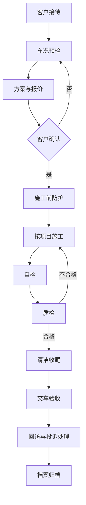

# 汽车维修美容服务操作手册

- 版本：V1.0
- 编制日期：2026-11-17
- 适用范围：汽车美容装饰店、维修厂美容车间、4S 店精品美容部的洗车、漆面护理、内饰清洗、贴膜、漆面保护膜施工与服务管理全流程
- 配套文档：《汽车售后服务操作手册》（同层级 auto-after-sales-docs 目录）
- 使用说明：本手册为通用作业规范，具体产品施工方法、耗材型号以产品说明书和本公司作业指导书为准

---

## 1. 目的

统一汽车维修美容各服务项目的操作标准、工艺要求和服务规范，做到：

1. 洗车、精洗、漆面护理、内饰清洗、贴膜、车衣施工各环节有标准工艺；
2. 施工前车况预检、施工中防护、施工后质检有记录可追溯；
3. 耗材、工具、设备使用规范，不损伤车辆；
4. 客户诉求响应及时，投诉闭环处理；
5. 安全生产、消防、环保合规，不发生事故。

---

## 2. 岗位与职责

| 岗位 | 主要职责 | 关键产出 |
|---|---|---|
| 服务顾问 | 项目接待、车况预检、方案报价、客户沟通 | 美容服务单、报价单 |
| 美容技师 | 按工艺施工、自检、工具设备维护 | 施工记录、自检表 |
| 贴膜技师 | 窗膜/车衣施工、烤膜、赶水、边角处理 | 贴膜施工单 |
| 质检员 | 施工质量终检、交付验收 | 质检报告 |
| 库管员 | 耗材、膜材、化工品采购、入库、出库、盘点 | 耗材台账 |
| 安全管理员 | 消防安全、用电安全、危化品管理、应急预案 | 安全检查记录 |

原则：施工与质检不得由同一人操作；化工品使用须佩戴防护用品；贴膜、车衣等高价项目须由认证技师施工。

---

## 3. 服务项目分类

| 大类 | 项目 | 说明 |
|---|---|---|
| 清洗 | 普洗、精洗、发动机舱清洗、底盘清洗 | 车身及部件清洁 |
| 漆面护理 | 打蜡、封釉、镀膜、镀晶、抛光研磨 | 漆面保护与修复 |
| 内饰护理 | 内饰精洗、真皮养护、塑料件翻新、除味除菌 | 车内清洁养护 |
| 贴膜 | 车窗太阳膜、全景天窗膜、隔热膜 | 玻璃贴膜 |
| 漆面保护膜 | 隐形车衣（TPU/TPH）、改色膜 | 漆面保护/改色 |
| 玻璃养护 | 玻璃镀膜、雨敌、玻璃修复 | 玻璃防护 |
| 轮胎轮毂 | 轮胎上光、轮毂清洗、胎壁养护 | 轮胎轮毂养护 |

---

## 4. 服务全流程总览

| 阶段 | 关键动作 | 输出 | 常见阻断 |
|---|---|---|---|
| 预检 | 漆面、玻璃、内饰、边缝检查，登记原有损伤 | 车况预检单 | 原有损伤未登记，事后纠纷 |
| 报价 | 项目、耗材、工期、质保说明 | 报价单 | 客户对价格异议 |
| 施工 | 按工艺标准作业，关键节点拍照 | 施工照片 | 天气（湿度/温度）影响贴膜 |
| 质检 | 强光手电检查、边角检查、功能测试 | 质检报告 | 边角起翘、尘点、漏抛 |
| 交车 | 项目说明、质保告知、验收签字 | 交付验收单 | 客户对效果不满意 |

---

## 5. 洗车服务

### 5.1 普洗标准流程

1. **预冲洗**：高压水枪由上至下冲洗车身，去除浮尘和松散污垢，水压控制在合适范围避免损伤漆面；
2. **泡沫覆盖**：泡沫枪均匀喷洒专业洗车液，全车覆盖，停留 3-5 分钟使污垢软化，不得干燥；
3. **手工清洗**：柔软海绵或洗车手套，直线移动轻柔擦洗，顺序为顶部 → 侧面 → 前后 → 下部（由上到下，避免脏水污染已洗区域）；
4. **轮毂清洗**：专用轮毂刷配合轮毂清洗剂，单独处理；
5. **冲洗**：由上至下冲净泡沫，重点冲洗边缝、门把手、后视镜；
6. **吹干**：气枪吹干边缝、后视镜、门把手积水，防止水印；
7. **擦干**：超细纤维毛巾按部位分区擦干，不混用；
8. **基础清洁**：内饰吸尘、仪表台擦拭、玻璃清洁、轮胎上光。

### 5.2 两桶水法（精洗核心）

为降低洗车划痕风险，精洗采用两桶水法：

1. 一桶为洗车液水，一桶为清水；
2. 洗车手套在洗车液桶沾取泡沫后擦洗车身；
3. 擦洗后在清水桶中彻底投洗手套，拧干后再沾泡沫；
4. 顺序由上至下，分区域作业，避免脏手套污染清洁区域。

### 5.3 精洗标准（参考 T/BQYX 001-2025《汽车精洗》）

精洗在普洗基础上增加以下内容：

| 部位 | 清洁要求 |
|---|---|
| 发动机舱 | 表面无油污、线束无浮尘，避开电气元件直接冲水 |
| 门框边缝 | 无泥沙、无污渍 |
| 轮毂内侧 | 无刹车片粉末、无油污 |
| 油箱盖内侧 | 无污渍 |
| 后备箱沟槽 | 无泥沙 |
| 空调出风口 | 无灰尘 |
| 座椅缝隙 | 无杂物 |
| 全车门板门边框 | 无污渍 |
| 玻璃 | 无水印、无指纹、透光清晰 |

检测工具：强光手电。

### 5.4 洗车注意事项

1. 不在烈日下洗车，避免水渍斑；
2. 不使用洗洁精、洗衣粉等碱性清洁剂，损伤漆面；
3. 高压水枪不得直射密封胶条、电气元件；
4. 发动机舱清洗须在冷车状态下进行，用塑料膜遮蔽发电机、保险盒、ECU、进气口等；
5. 新能源车辆高压部件区域避免直接冲水。

---

## 6. 漆面护理

### 6.1 漆面评估

1. 强光下检查漆面：氧化层、划痕（发丝纹/深度划痕）、水渍、沥青、树胶；
2. 用洗车泥（粘土）配合润滑液轻擦漆面，感受粗糙颗粒，判断氧化程度；
3. 与客户确认处理方案：发丝纹可抛光，深度划痕需补漆。

### 6.2 抛光研磨

依据《洗车服务质量规范》DB 23/T 2757—2020：

1. 清洗车身，彻底干燥；
2. 车灯、商标、橡胶条、塑料件等非施工区遮蔽；
3. 研磨剂涂在海绵研磨盘接触面中间，研磨抛光机不得倾斜使用；
4. 车身边角宜用干毛巾沾研磨剂手工研磨，不用力研磨；
5. 研磨时保持研磨盘和漆面常温，避免过热灼伤漆面；
6. 抛光后用去铁粉、去油污剂清洁漆面，为镀膜/镀晶做准备。

### 6.3 打蜡/封釉/镀膜/镀晶

| 项目 | 主要成分 | 保持周期 | 特点 |
|---|---|---|---|
| 打蜡 | 棕榈蜡/合成蜡 | 1-3 个月 | 成本低，光泽好，保护性一般 |
| 封釉 | 聚合物釉质 | 3-6 个月 | 渗透性好，硬度高于打蜡 |
| 镀膜 | 玻璃纤维素/硅素 | 6-12 个月 | 硬度较高，疏水性好 |
| 镀晶 | 二氧化硅/二氧化钛 | 1-3 年 | 硬度高（6H+），保护性强，需专业施工 |

施工要点：
1. 镀晶前漆面必须彻底清洁、去油污、干燥；
2. 镀晶液薄涂均匀，等待结晶时间按产品说明；
3. 镀晶后 24 小时内不得沾水，7 天内不得洗车；
4. 施工环境要求无尘、温度适宜（15-30℃）、湿度适中。

### 6.4 漆面保护膜（隐形车衣）

| 材质 | 特点 |
|---|---|
| TPU | 热塑性聚氨酯，划痕自修复，韧性好，使用寿命长（5-10 年），价格高 |
| TPH | 热塑性弹性体，价格低，耐候性一般，易黄变 |

施工流程：
1. 车况预检：漆面检查，登记原有划痕；
2. 整车清洗：精洗+去铁粉+去油污，保证漆面无杂质；
3. 裁膜：专车专用数据裁膜或手工裁膜；
4. 定位铺膜：将膜覆盖对应部位，预留包边余量；
5. 赶水贴合：专业刮板排出安装液，使膜贴合车身曲面；
6. 边角处理：车衣包裹进车门边缘、接缝部位，实现"隐形"效果；
7. 收边烘干：烤枪收边，确保边角牢固不起翘；
8. 质检：强光检查尘点、气泡、边角，不合格处返工。

注意事项：
- 施工需在无尘车间进行，温湿度受控；
- 施工后 3 天内不得洗车，7 天内不得高速行驶；
- 膜面划痕可通过加热自修复（TPU）。

---

## 7. 内饰护理

### 7.1 内饰精洗

1. **物品整理**：取出车内个人物品，分类存放；
2. **吸尘**：座椅、地毯、后备箱、缝隙全面吸尘；
3. **顶棚清洗**：专用内饰清洗剂，软毛刷刷洗，超细纤维毛巾擦干，避免渗水；
4. **仪表台/中控**：中性清洗剂擦拭，避开电器按键，不直接喷在电子设备上；
5. **座椅**：织物座椅用泡沫清洗剂刷洗吸干；真皮座椅用专用皮革清洁剂；
6. **门板/塑料件**：清洗剂刷洗，擦干后可涂塑料件养护剂；
7. **玻璃内侧**：玻璃清洁剂，超细纤维毛巾，无水印无条纹；
8. **除味除菌**：臭氧消毒或光触媒处理，去除异味。

### 7.2 真皮养护

1. 专用皮革清洁剂清洁，去除污渍；
2. 皮革护理乳均匀涂抹，滋润皮革，防止干裂；
3. 避免使用含硅油、酒精的产品，损伤真皮；
4. 定期养护（建议每 3 个月一次）。

### 7.3 内饰清洗注意事项

1. 电气设备（音响、开关、屏幕）不得直接喷清洗剂；
2. 顶棚清洗不得用力过猛，避免脱层；
3. 清洗剂须先在隐蔽处试用，确认不褪色、不变色；
4. 清洗后充分通风干燥，防止霉变。

---

## 8. 贴膜服务

### 8.1 窗膜（太阳膜）施工

1. **车况预检**：检查玻璃有无划痕、裂纹、瑕疵，登记确认；
2. **施工环境**：无尘车间，降尘处理，温湿度适宜；
3. **玻璃清洁**：专用玻璃清洁剂彻底清洁玻璃内外，去油污、去胶；
4. **裁膜**：按玻璃尺寸裁膜，预留余量；
5. **烤膜定型**：外侧烤膜，使膜贴合玻璃曲面；
6. **装贴**：内侧玻璃喷安装液，膜定位，刮板由中心向外赶水排空气；
7. **边缝检查**：定向光下检查边缘，发现尘点及时处理；
8. **烘干固化**：室内静置固化，交付前确认边缘无起翘。

### 8.2 贴膜注意事项

1. 贴膜后 3-7 天内不得升降车窗，避免膜移位；
2. 贴膜后 1 个月内不得粘贴吸盘等物品；
3. 膜面有轻微水汽、模糊属正常现象，随水分蒸发消失；
4. 前挡膜须使用高透光率产品（透光率不低于 70%，符合 GB 7258 要求）；
5. 不得张贴镜面反光膜、不透明膜，违反交规。

---

## 9. 施工安全与防护

### 9.1 车辆防护

1. 施工前安装方向盘套、座椅套、脚垫；
2. 非施工区域用遮蔽膜、美纹纸保护；
3. 抛光、镀膜时遮蔽车灯、橡胶条、塑料件；
4. 贴膜时保护仪表台、座椅免受安装液浸湿。

### 9.2 人员防护

| 作业类型 | 防护用品 |
|---|---|
| 洗车/精洗 | 防水手套、防水鞋 |
| 抛光研磨 | 防尘口罩、护目镜、手套 |
| 镀膜/镀晶 | 防毒口罩（防有机蒸气）、手套、护目镜 |
| 内饰清洗 | 口罩、手套 |
| 发动机舱清洗 | 护目镜、手套 |

### 9.3 设备与用电安全

1. 抛光机、烤枪等电动设备使用前检查线缆、插头；
2. 设备不得带病作业，发现异常立即停用；
3. 用电设备接地良好，湿手不得操作电气设备；
4. 高压水枪使用后及时关闭，水管归位。

### 9.4 消防安全

1. 美容车间配备灭火器、消防沙，定期检查；
2. 化工品（汽油、清洗剂、镀膜液）分类存放，远离火源；
3. 严禁车间内吸烟、明火作业；
4. 制定火灾应急预案，定期演练。

---

## 10. 耗材与化工品管理

### 10.1 耗材分类

| 类别 | 示例 |
|---|---|
| 清洁剂 | 洗车液、轮毂清洗剂、内饰清洗剂、玻璃清洁剂 |
| 护理剂 | 车蜡、镀晶液、皮革护理乳、轮胎上光剂 |
| 研磨剂 | 粗蜡、中蜡、细蜡、镜面还原剂 |
| 膜材 | 太阳膜、隐形车衣、改色膜 |
| 工具 | 洗车手套、海绵、毛巾、刮板、烤枪、抛光机 |

### 10.2 管理要求

1. 建立耗材台账，记录采购、入库、出库、库存；
2. 化工品张贴中文标签，注明成分、用途、有效期、安全注意事项；
3. 先进先出，过期耗材不得使用；
4. 危险品（易燃、腐蚀）专柜存放，双人双锁；
5. 留存耗材合格证明、采购凭证，做到可追溯。

---

## 11. 质量管理与交付

### 11.1 三级质检

| 级别 | 执行人 | 内容 |
|---|---|---|
| 自检 | 施工技师 | 按项目标准逐项检查，签字 |
| 互检 | 班组/组长 | 关键工序复核 |
| 终检 | 质检员 | 强光手电全面检查，签字 |

### 11.2 交付标准

| 项目 | 验收标准 |
|---|---|
| 普洗 | 车身无污渍、无水印、玻璃透亮、轮胎上光 |
| 精洗 | 边缝无泥沙、发动机舱清洁、内饰无灰尘、玻璃无水印 |
| 漆面护理 | 漆面光亮、无旋纹、边角处理到位、疏水性好 |
| 贴膜 | 无明显尘点、无气泡、边缘无起翘、透光清晰 |
| 车衣 | 无气泡、无折痕、边角包裹到位、无明显拼接缝 |
| 内饰 | 无污渍、无异味、各部件功能正常 |

### 11.3 质保与售后

1. 各项目向客户说明质保范围与期限；
2. 镀晶、车衣、贴膜等项目提供质保卡；
3. 质保期内出现施工质量问题（非人为、非外力）免费返修；
4. 建立施工档案，记录项目、耗材、技师、日期，便于售后查询。

---

## 12. 客户投诉处理

### 12.1 投诉受理

1. 渠道：到店、电话、微信、评价平台、12315；
2. 登记：投诉人、车牌号、投诉事项、诉求、发生时间；
3. 响应：专人负责，及时回复，不推诿；
4. 保留投诉处理记录，定期分析总结。

### 12.2 处理原则

1. **先安抚情绪，再核实事实**：调阅施工记录、照片，厘清责任；
2. **属施工质量问题**：免费返修或按约定赔偿；
3. **属客户使用不当**：耐心解释，提供解决方案；
4. **协商不成**：引导通过消费者协会、市场监管部门调解。

### 12.3 常见投诉与处理

| 投诉类型 | 处理方式 |
|---|---|
| 漆面炫光/划痕 | 确认是否施工造成，是则免费重抛 |
| 贴膜尘点/气泡 | 质保期内免费重贴局部 |
| 内饰变色/损伤 | 核实是否清洗剂导致，协商赔偿 |
| 车衣起翘 | 质保期内免费收边或重贴 |
| 价格争议 | 出示报价单和项目明细，核对确认 |

---

## 13. 合规红线

以下行为严禁触碰：

1. **使用假冒伪劣耗材**：劣质镀晶液、车蜡损伤漆面，劣质膜释放有害气体；
2. **违规贴膜**：前挡透光率低于 70%、张贴镜面反光膜，违反 GB 7258；
3. **隐瞒原有损伤**：未预检登记，将原有损伤归咎施工；
4. **虚假宣传**：夸大产品性能、质保期限，误导客户；
5. **强制消费**：强制搭售项目、隐瞒收费；
6. **违规排放**：洗车污水、废油未按规定处理，污染环境；
7. **消防隐患**：化工品违规存放、车间明火、消防设施缺失；
8. **个人信息泄露**：客户信息、车辆信息外泄。

---

## 14. 常用法规与标准

| 法规/标准 | 要点 |
|---|---|
| 《洗车服务质量规范》DB 23/T 2757—2020 | 洗车、研磨抛光、投诉处理质量要求 |
| 《汽车精洗》T/BQYX 001-2025 | 精洗清洁用品要求、质量检测标准 |
| 《汽车美容装饰服务规范》T/CADA | 经营管理、安全防范、服务制度要求 |
| 《机动车维修管理规定》（交通运输部令 2023 年第 14 号） | 维修质量、配件追溯、质量保证期 |
| 《机动车运行安全技术条件》GB 7258 | 前挡玻璃透光率不低于 70% |
| 《中华人民共和国消费者权益保护法》 | 消费者知情权、公平交易权 |
| 《中华人民共和国消防法》 | 消防安全责任与义务 |
| 《危险化学品安全管理条例》 | 化工品采购、存储、使用规范 |

---

## 15. 附：客户常见问题速查

| 问题 | 标准答复要点 |
|---|---|
| 镀晶和打蜡有什么区别？ | 打蜡保持 1-3 个月，成本低；镀晶保持 1-3 年，硬度高保护性强，需专业施工 |
| 隐形车衣值不值得贴？ | 可防石子、划痕、鸟粪腐蚀，TPU 材质有划痕自修复，适合新车和高档车 |
| 贴膜后多久能开窗？ | 3-7 天，具体看膜材和天气，避免膜移位起翘 |
| 精洗和普洗有什么区别？ | 精洗增加发动机舱、边缝、轮毂内侧、内饰细节深度清洁，耗时长、效果好 |
| 内饰清洗会不会伤真皮？ | 使用专用皮革清洁剂和护理乳，不会损伤，反而是养护；不使用含酒精、硅油的劣质产品 |
| 镀晶后多久能洗车？ | 24 小时内不沾水，7 天内不洗车，确保结晶完全固化 |
| 你们用的产品环保吗？ | 正规品牌产品，符合国家标准，施工后通风，无明显异味 |
| 施工后出现问题怎么办？ | 每个项目都有质保期，施工质量问题免费返修，请保留施工单和质保卡 |

---

*本手册由信息整理编制，具体产品施工方法以产品说明书和本公司作业指导书为准。*
