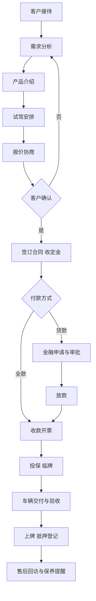
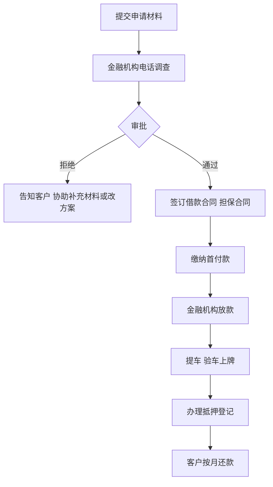

# 汽车销售操作手册

- 版本：V1.0
- 编制日期：2026-11-17
- 适用范围：乘用车（燃油车、新能源车）4S 店/经销店的新车销售、二手车置换与销售、汽车金融分期、交付与售后衔接全流程
- 使用说明：本手册为通用作业规范，具体车型配置、金融产品、属地政策以本公司作业手册和当地监管要求为准

---

## 1. 目的

统一汽车销售各环节的操作步骤、信息口径和合规要求，做到：

1. 客户接待、需求分析、产品介绍、试驾、报价、签约、交付各环节有标准动作；
2. 报价、合同、收款、发票、交付凭证齐全可追溯；
3. 定金/订金、贷款、保险、置换等关键事项向客户充分告知，不留合规隐患；
4. 提车环节"三证一票"齐全，车况与合同一致，避免交付纠纷。

---

## 2. 岗位与职责

| 岗位 | 主要职责 | 关键产出 |
|---|---|---|
| 销售顾问 | 接待、需求分析、产品介绍、试驾安排、报价、跟进、签约配合 | 客户需求记录、报价单、订单 |
| 销售经理 | 价格审批、折扣授权、疑难客户洽谈、合同审核 | 价格审批记录、合同复核意见 |
| 金融专员 | 贷款申请、资料收集、审批跟进、抵押登记 | 贷款申请材料、放款凭证 |
| 保险专员 | 险种方案、报价、出单、保单送达 | 保单、发票 |
| 交付专员 | 车辆验收、手续交接、功能讲解、客户回访 | 交付验收单、回访记录 |
| 二手车评估师 | 置换车辆检测、估价、收购合同 | 检测报告、收购协议 |

原则：销售与收款、销售与核价、金融与销售不得由同一人越权操作；所有价格让步必须有书面审批。

---

## 3. 新车销售全流程总览

| 阶段 | 关键动作 | 输出 | 常见阻断 |
|---|---|---|---|
| 接待 | 迎客、需求初步了解、建立信任 | 客户登记卡 | 客户仅"随便看看"，意愿不明 |
| 需求分析 | 购车用途、预算、付款方式、决策人、置换需求 | 需求确认表 | 预算与目标车型不匹配 |
| 产品介绍 | 六方位绕车、配置讲解、竞品对比 | 产品讲解记录 | 客户关注点与车型卖点错位 |
| 试驾 | 试驾协议、路线、体验项 | 试驾反馈表 | 无证、驾龄不足、无预约 |
| 报价 | 车价、购置税、保险、上牌、金融方案 | 报价单 | 客户对价格异议 |
| 签约 | 合同条款、定金、交付时间 | 销售合同、定金收据 | 定金/订金混淆、条款不清 |
| 交付 | 车况验收、手续交接、功能讲解 | 交付验收单 | 三证一票不齐、车况不符 |

---

## 4. 客户接待与需求分析

### 4.1 接待标准

1. 客户到店 30 秒内主动迎接，自我介绍并递名片；
2. 提供饮品，引导至洽谈区，不急于推销；
3. 对线上预约客户，提前准备车型资料与报价预案。

### 4.2 需求分析要点

| 维度 | 关键问题 | 用途 |
|---|---|---|
| 购车用途 | 家用/商务/通勤/越野？几人乘坐？ | 匹配车型级别 |
| 预算范围 | 裸车预算？落地预算？是否包含置换补贴？ | 筛选车型 |
| 付款方式 | 全款/贷款？贷款首付比例、期限偏好？ | 匹配金融方案 |
| 决策人 | 本人决策还是家人共同决策？ | 确定关键沟通对象 |
| 用车时间 | 何时提车？是否有现车要求？ | 安排资源 |
| 置换需求 | 是否有旧车置换？品牌、年份、里程？ | 安排评估 |
| 关注重点 | 空间/动力/油耗/智能化/保值率？ | 产品讲解侧重 |

### 4.3 常见客户类型与应对

| 类型 | 特征 | 应对策略 |
|---|---|---|
| 随便看看型 | 无明确目标，怕被推销 | 不施压，以开放式问题挖掘需求，提供资料让其自行了解 |
| 目标明确型 | 已做功课，直奔某车型 | 直接切入配置与价格，重点处理异议 |
| 对比纠结型 | 在 2-3 款车型间犹豫 | 做对比表，突出目标车型差异化优势 |
| 价格敏感型 | 反复砍价 | 强调综合价值（配置、服务、金融方案），而非单纯降价 |

---

## 5. 产品介绍与试驾

### 5.1 六方位绕车介绍

按车前、车侧、车后、车后座、驾驶座、引擎盖六个方位依次讲解，每个方位突出 2-3 个核心卖点，结合客户需求重点展开。

### 5.2 竞品对比

针对客户提及的竞品，准备客观对比表，覆盖：

| 对比项 | 本品牌车型 | 竞品 A | 竞品 B |
|---|---|---|---|
| 指导价 |  |  |  |
| 车身尺寸 |  |  |  |
| 动力参数 |  |  |  |
| 核心配置 |  |  |  |
| 质保政策 |  |  |  |
| 保值率 |  |  |  |

原则：不贬低竞品，用数据和事实说话，引导客户关注自身需求匹配度。

### 5.3 试驾管理

1. 试驾前：核验驾驶证（驾龄满 1 年）、签署试驾协议、确认试驾路线；
2. 试驾中：先由销售顾问驾驶演示，再交由客户试驾，全程讲解体验项；
3. 试驾后：立即填写试驾反馈表，引导客户回到洽谈区继续推进。

---

## 6. 报价与异议处理

### 6.1 报价构成

报价单应明确列出以下项目，避免"一口价"模糊报价：

| 项目 | 说明 |
|---|---|
| 裸车价 | 车辆成交价格（含优惠后） |
| 购置税 | 裸车价 / 11.3（新能源车免征，以当地政策为准） |
| 交强险 | 法定强制保险 |
| 商业险 | 车损险、三者险等，按客户需求配置 |
| 上牌费 | 车管所费用 + 代办服务费 |
| 金融服务费 | 贷款购车时收取，须明示 |
| 装潢/精品 | 客户选装项目 |
| 置换补贴 | 旧车置换补贴金额 |
| 落地总价 | 以上各项合计 |

### 6.2 异议处理框架

采用"共情 - 澄清 - 价值"三步法：

1. **共情**："我理解您的顾虑，很多客户一开始也有同样的想法。"
2. **澄清**：用开放式问题挖掘真实异议，"您主要是觉得哪方面不太满意？"
3. **价值**：针对真实异议提供解决方案，用数据和案例支撑。

### 6.3 常见异议话术

| 异议 | 应对思路 |
|---|---|
| "太贵了" | 拆解落地价，对比同级别配置；强调金融方案降低月供压力；突出保值率和质保 |
| "我再想想" | 询问具体顾虑点；说明限时优惠或现车资源；约定下次跟进时间 |
| "别的店更便宜" | 核实对方报价是否含全部费用；强调本店服务保障与正规渠道；申请价格审批 |
| "这车保值率怎么样" | 提供品牌保值率数据；说明质保政策与残值保障方案 |
| "我要回去和家人商量" | 确认决策人；提出可陪同家人再次到店；发送车型资料供家人参考 |
| "现在不急" | 了解用车时间节点；提供现车资源与交付周期信息；建立长期跟进 |

### 6.4 价格让步原则

1. 任何价格让步必须经销售经理书面审批；
2. 让步逐步进行，不一次性放到底；
3. 让步同时绑定条件（如当天签约、全款、搭配装潢等）；
4. 不承诺合同外的口头优惠。

---

## 7. 合同签订与定金

### 7.1 定金与订金的区别

| 项目 | 定金 | 订金 |
|---|---|---|
| 法律性质 | 具有担保性质，适用定金罚则 | 预付款性质，不适用罚则 |
| 客户违约 | 无权要求返还 | 可要求返还（扣除合理费用） |
| 商家违约 | 双倍返还 | 原额返还 |
| 金额上限 | 不得超过主合同标的额的 20% | 无强制上限 |

依据：《中华人民共和国民法典》第五百八十六条、第五百八十七条。

### 7.2 合同必备条款

销售合同必须包含以下要素：

1. **车辆信息**：品牌、型号、配置、颜色、车架号（如有现车）、发动机号；
2. **价格条款**：裸车价、各项费用明细、落地总价；
3. **付款方式**：全款/贷款、定金金额、首付款、尾款支付时间；
4. **交付条款**：交付时间、交付地点、交付时车况标准；
5. **违约责任**：逾期交付、客户违约的处理方式；
6. **质量与三包**：三包凭证、质保期限、退换车条件；
7. **争议解决**：协商、投诉、诉讼途径。

### 7.3 签约注意事项

1. 拒绝"一经售出概不退换"等霸王条款；
2. 所有口头承诺必须写入合同附件；
3. 合同双方各执一份，加盖公章；
4. 定金收据需注明款项性质（定金/订金）。

---

## 8. 汽车金融分期业务

### 8.1 贷款申请材料

| 材料 | 说明 |
|---|---|
| 身份证 | 借款人及配偶 |
| 驾驶证 | 借款人 |
| 收入证明 | 单位开具或近 6 个月银行流水 |
| 居住证明 | 房产证/租赁合同/水电费单据 |
| 购车合同/订单 | 已签订的销售合同 |
| 首付凭证 | 首付款转账记录 |

部分金融机构还会要求社保、公积金记录或资产证明。

### 8.2 贷款流程

### 8.3 贷款产品类型

| 产品 | 特点 | 适用人群 |
|---|---|---|
| 等额本息 | 每月还款额相同 | 收入稳定客户 |
| 5050 方案 | 首付 50%，尾款 50%，期间低月供或零月供 | 短期资金周转客户 |
| 气球贷 | 前期月供低，末期大额尾款 | 预期未来收入增长客户 |
| 厂家金融贴息 | 厂家补贴利息，利率较低 | 指定车型客户 |

### 8.4 监管要求

依据《汽车贷款管理办法》（中国人民银行、中国银监会令 2017 年第 2 号修订）：

- 汽车贷款期限（含展期）不得超过 5 年；
- 二手车贷款期限（含展期）不得超过 3 年；
- 经销商汽车贷款期限不得超过 1 年；
- 贷款利率按中国人民银行公布的贷款利率规定执行。

### 8.5 合规要点

1. 不得以"零利息"等虚假宣传误导客户，须明示实际年化利率（IRR）；
2. 金融服务费须明码标价，不得强制搭售保险或装潢；
3. 不得收取合同未约定的费用；
4. 贷款合同须由客户本人签署，不得代签。

---

## 9. 车辆保险

新车销售通常搭配保险出单，要点如下：

1. **交强险**：法定强制，必须投保；
2. **商业险**：建议投保车损险、第三者责任险（建议 100 万以上）、车上人员责任险；
3. **新能源专项**：新能源车可投保新能源汽车损失保险，覆盖三电系统；
4. 保险费用按实际保费收取，不得捆绑不必要险种；
5. 保单须在交付前生效，确保提车即有保障。

---

## 10. 二手车销售

### 10.1 二手车收购/置换评估

1. **手续核查**：登记证书、行驶证、购置税完税证明、交强险、车主身份证；
2. **车况检测**：
   - 车身：漆膜仪测漆面厚度（原厂漆约 120μm，补漆增厚）、焊点检查；
   - 底盘：漏油、锈蚀、悬挂；
   - 发动机：异响、烧机油、排放；
   - 电气：灯光、中控、车窗、空调；
   - 排查泡水车（地毯霉味、线束生锈）、火烧车（内饰异味、金属件变色）、事故车（结构件损伤）；
3. **估价**：参考同款车型市场行情、车况、里程、年份；
4. **签订收购协议**：明确成交价、交车时间、过户责任、违章处理。

### 10.2 二手车销售流程

1. 车辆整备与检测报告公示；
2. 明码标价，标注车辆信息（年份、里程、车况等级）；
3. 签订二手车买卖合同，明确成交价、付款方式、过户时限、违章责任划分；
4. 开具二手车销售统一发票；
5. 办理转移登记（过户）。

### 10.3 过户所需材料

依据《二手车流通管理办法》和《二手车交易规范》：

- 买方及其代理人身份证明；
- 机动车登记证书；
- 机动车行驶证；
- 二手车销售统一发票；
- 属于解除海关监管的车辆，提供《中华人民共和国海关监管车辆解除监管证明书》。

### 10.4 卖方信息披露义务

二手车卖方应当向买方提供车辆的使用、修理、事故、检验以及是否办理抵押登记、交纳税费、报废期等真实情况和信息。买方购买的车辆如因卖方隐瞒和欺诈不能办理转移登记，卖方应当无条件接受退车，并退还购车款等费用。

二手车经销企业销售二手车时应当向买方提供质量保证及售后服务承诺。

---

## 11. 车辆交付

### 11.1 交付前准备

1. 确认车辆状态：清洁、PDI（售前检查）完成、油电充足；
2. 确认手续齐全：合格证、一致性证书、三包凭证、购车发票、保单、临时号牌；
3. 确认款项到账：全款到账或贷款放款；
4. 预约客户交付时间。

### 11.2 提车"三证一票"

| 凭证 | 说明 |
|---|---|
| 车辆合格证 | 车辆出厂合格证明，上牌必需 |
| 一致性证书 | 车辆参数与公告一致证明 |
| 三包凭证 | 家用汽车产品三包凭证 |
| 购车发票 | 机动车销售统一发票（注册登记联、报税联、发票联） |

缺一不可，严防"有车无证"无法上牌。

### 11.3 交付验收

1. 核对车架号（VIN）、发动机号与合同、合格证一致；
2. 外观检查：漆面、玻璃、轮胎、轮毂；
3. 内饰检查：座椅、中控、仪表盘、随车工具；
4. 功能测试：启动、灯光、空调、中控屏、车窗、雨刮、喇叭；
5. 新能源车辆：动力电池电量、充电功能、三电系统自检；
6. 核对随车物品：备胎、千斤顶、三角警示牌、反光背心、充电枪（新能源）；
7. 双方签署《车辆验收交接书》，车辆风险自交付时转移。

### 11.4 功能讲解与售后衔接

1. 讲解车辆主要功能操作；
2. 介绍质保政策与三包范围；
3. 说明首保时间与里程；
4. 介绍售后服务顾问与 24 小时救援电话；
5. 引导客户加入车主社群。

---

## 12. 上牌与抵押登记

### 12.1 上牌流程

1. 缴纳购置税（新能源车免征）；
2. 购买交强险；
3. 车管所验车、选号；
4. 领取行驶证、登记证书、号牌；
5. 抵押登记（贷款车辆）：将登记证书抵押给金融机构，贷款结清后解押。

### 12.2 临牌管理

交付至正式上牌期间使用临时行驶车号牌：

- 临牌有效期一般 15-30 天；
- 临牌过期不得上路；
- 临牌须张贴在前后挡风玻璃指定位置。

---

## 13. 客户回访与关系维护

| 回访节点 | 回访内容 | 目的 |
|---|---|---|
| 交付后 3 天 | 用车体验、功能疑问解答 | 提升满意度 |
| 交付后 1 个月 | 首保提醒、使用情况 | 保养转化 |
| 交付后 3 个月 | 满意度调查、转介绍邀约 | 口碑传播 |
| 节日/生日 | 关怀问候 | 关系维护 |

---

## 14. 合规红线

以下行为严禁触碰：

1. **虚假宣传**：夸大配置、隐瞒缺陷、虚假金融利率；
2. **强制搭售**：强制购买保险、装潢、延保；
3. **价格欺诈**：低标高结、价外加价、收取未明示费用；
4. **合同违规**：定金超过 20%、霸王条款、口头承诺不写入合同；
5. **手续违规**：无合格证交车、伪造证件、不开发票；
6. **个人信息违规**：未经客户同意泄露或滥用客户信息；
7. **二手车违规**：隐瞒事故/泡水/火烧、不履行信息披露义务。

---

## 15. 常用法规与标准

| 法规/标准 | 要点 |
|---|---|
| 《中华人民共和国民法典》 | 定金罚则、合同效力、违约责任 |
| 《汽车贷款管理办法》 | 贷款期限、利率、业务规范 |
| 《二手车流通管理办法》 | 二手车经营行为规范、信息披露 |
| 《二手车交易规范》 | 交易流程、过户材料 |
| 《家用汽车产品修理更换退货责任规定》 | 三包责任、退换车条件 |
| 《汽车经销及售后服务规范指引》 | 经销服务通用规范 |
| 《机动车销售统一发票使用规定》 | 发票开具规范 |

---

## 16. 附：客户常见问题速查

| 问题 | 标准答复要点 |
|---|---|
| 定金能退吗？ | 定金适用定金罚则，客户违约不退，商家违约双倍返还；订金为预付款可协商退还 |
| 贷款可以提前还款吗？ | 大部分金融产品支持提前还款，可能有违约金，具体以合同约定为准 |
| 交车时间能保证吗？ | 现车可按合同约定交付，订车车型受厂家排产影响，合同约定最晚交付时间 |
| 保险必须在店里买吗？ | 交强险法定，商业险客户可自主选择，店内提供便利服务 |
| 二手车有质保吗？ | 正规经销企业销售二手车应提供质量保证及售后服务承诺，具体以合同为准 |
| 新能源车三电质保多久？ | 各品牌政策不同，通常动力电池质保 8 年/15 万公里以上，以厂家政策为准 |

---

*本手册由信息整理编制，具体业务操作以本公司制度与当地监管要求为准。*
