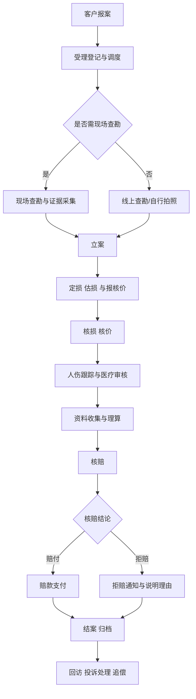

# 车险理赔操作手册与条款

- 版本：V1.0
- 编制日期：2026-11-17
- 适用：交强险、商业车险（2020 版）、新能源汽车商业保险的理赔作业
- 依据：《保险法》、《机动车辆保险理赔管理指引》（保监发〔2012〕15 号）、《机动车辆保险理赔服务规范》（T/IAC 52—2024）、交强险条款、机动车商业保险示范条款（2020 版）、新能源汽车商业保险示范条款（试行）、《车险承保理赔实务指南（2026 版）》
- 配套文档：《车险报价与出单操作手册》《车险责任与条款速查》（同目录）
- 使用说明：本手册为通用作业规范，具体赔案权限、系统操作与属地服务标准以本公司制度和当地监管要求为准

---

# 上篇 理赔操作手册

## 1. 总则与岗位

### 1.1 理赔的完整环节

车险理赔是指保险人收到出险通知后，依据法律法规和保险合同，调查核实事故损失事实、核定保险责任并赔偿保险金的行为。完整环节包括：

报案受理 → 调度 → 查勘 → 立案 → 定损（估损） → 人身伤亡跟踪（调查） → 报核价 → 核损 → 医疗审核 → 资料收集 → 理算 → 核赔 → 结销案 → 赔款支付 → 追偿及损余物资处理 → 客户回访 → 投诉处理 → 特殊案件处理。

### 1.2 岗位与职责

| 岗位 | 主要职责 | 关键产出 |
|---|---|---|
| 接报案岗 | 受理报案、登记信息、判断案件类型、调度 | 报案记录、调度指令 |
| 查勘岗 | 现场查勘、核实事故真实性、采集证据 | 查勘报告、影像资料 |
| 定损岗 | 车辆拆解定损、修复方案与金额核定 | 定损单、核价依据 |
| 人伤岗 | 人伤跟踪、医疗审核、伤残与误工核定 | 人伤调查报告、医疗审核意见 |
| 核价核损岗 | 配件价格、工时费率、核损金额审核 | 核损意见 |
| 理算岗 | 责任比例、免赔、赔款计算 | 理算书 |
| 核赔岗 | 责任认定、单证与金额复核、核赔结论 | 核赔结论 |
| 支付/财务岗 | 赔款支付、账户核验、凭证归档 | 支付凭证 |
| 追偿岗 | 代位求偿、垫付追偿、诉讼配合 | 追偿台账 |
| 档案岗 | 赔案归档、影像与单证管理 | 赔案档案 |

岗位互斥要求：

- 核保岗位不得与核损、核价、核赔岗位兼任；
- 同一赔案中，查勘、定损与核赔不得兼任，核损与核赔不得兼任；
- 授权金额内查勘、定损与核损可兼任，理算与核赔可兼任，但必须有严格的事中、事后抽查监督；
- 核损、核价、医疗审核、核赔等关键岗位原则上由总公司集中管理或垂直管理。

### 1.3 权限与分级

- 按人员专业技能与考核评级授予不同金额、不同类型案件的审核权限（从人授权优先）；
- 特殊案件审批上收：案件注销与恢复、重开赔案、通融赔付、拒赔、预付赔款、诉讼案件、追偿案件；
- 超权限案件逐级上报，不得先赔后批。

---

## 2. 全流程



各环节交接必须留痕：报案记录、调度指令、查勘报告、定损单、核损意见、医疗审核意见、理算书、核赔结论、支付凭证、结案记录，形成可回溯的完整链条。

---

## 3. 报案受理

### 3.1 受理要求

- 报案渠道：电话、APP、官网、微信公众号、柜面、合作渠道转办；
- 受理时使用统一话术，先确认人员安全与是否需要救援、报警、急救；
- 报案记录实时录入系统，生成唯一报案号，不得手工补录或事后编造；
- 对不属于保险责任的报案，也须登记并说明后续处理方式。

### 3.2 必采信息

| 类别 | 内容 |
|---|---|
| 保单信息 | 保单号、被保险人、车牌号、险种、保险期间 |
| 事故信息 | 出险时间、地点、天气、事故类型（单方/双方/多方/人伤/盗抢/火灾/水淹）、经过 |
| 人员信息 | 驾驶人姓名、驾驶证号、联系方式、是否受伤、是否酒驾嫌疑 |
| 车辆信息 | 车牌、车型、VIN、受损部位、能否行驶 |
| 现场情况 | 是否报警、是否已移动车辆、是否有监控、对方车辆与人员信息 |
| 其他 | 是否涉及第三方财产、货物、公共设施、是否已通知交警与急救 |

### 3.3 报案分类与调度

| 类型 | 调度安排 |
|---|---|
| 仅车损、责任清晰、损失较小 | 线上查勘或引导客户自助拍照，快速理赔通道 |
| 双方/多方事故 | 现场查勘，核实责任与痕迹，必要时调取监控 |
| 涉及人伤 | 人伤岗同步介入，跟踪治疗与伤残鉴定 |
| 盗抢 | 核实报案与立案证明，指导客户向公安刑侦部门报案 |
| 火灾、自燃、新能源起火 | 现场查勘，注意安全防护，必要时联系消防与厂家检测 |
| 水淹 | 现场查勘水淹高度、是否二次启动，安排施救与拆解 |
| 营运车、网约车 | 核实使用性质与营运资质，重点核查改变使用性质 |
| 异地出险 | 按"异地出险、就地理赔"原则委托当地机构或合作公估 |

### 3.4 报案环节的合规要求

- 事故发生后 48 小时内通知保险人；全车盗抢应在 24 小时内向出险地公安刑侦部门报案并通知保险人；
- 不得向客户承诺赔付金额或赔付结论；
- 不得引导客户放弃报警、伪造现场或改变事故陈述；
- 对疑似酒驾、毒驾、换驾、骗赔情形，记录疑点并按反欺诈流程处理。

---

## 4. 查勘与立案

### 4.1 查勘时效

行业服务规范要求（T/IAC 52—2024）：

| 查勘地点 | 到达时限 |
|---|---|
| 城市城区 | 45 分钟内 |
| 城市郊区 | 1 小时内 |
| 市辖县（市） | 按当地行业标准与公司承诺执行 |

无法按时到达的，应提前联系客户说明并约定时间；客户自行拍照的，应提供清晰的拍摄指引。

### 4.2 现场查勘要点

1. **证件核验**：行驶证、驾驶证、身份证、保单信息与实车一致；驾驶证在有效期内且准驾车型相符。
2. **驾驶人核实**：确认实际驾驶人，核对陈述与现场痕迹、监控、行车记录仪是否一致，排查换驾、顶包。
3. **事故真实性**：碰撞痕迹高度与角度、散落物、路面制动痕迹、车辆受损部位与陈述是否吻合。
4. **现场环境**：道路状况、视线、天气、信号灯、标志标线，判断事故成因与责任。
5. **第三方情况**：对方车辆、人员、财产损失，公共设施损坏，货物损失。
6. **酒驾毒驾嫌疑**：观察神态、气味、言语，及时报警并由交管部门检测，不得自行认定。
7. **施救与减损**：指导客户采取合理施救措施，防止损失扩大。
8. **安全防护**：高速公路、夜间、雨雪、新能源起火漏电场景，先确保人员安全再查勘。

### 4.3 证据与影像清单

- 车辆四角、受损部位近景与全景；
- 车牌、VIN、行驶证、驾驶证；
- 事故现场全景、路面痕迹、散落物；
- 对方车辆与证件、第三方财产损失；
- 人伤部位、医院诊断证明（涉人伤）；
- 行车记录仪、监控视频（及时固定，防止覆盖）；
- 施救与拖车记录、维修厂接车单。

影像应带时间信息，原始文件不得裁剪篡改，与报案号、赔案号关联保存。

### 4.4 立案

- 查勘后符合立案条件的，及时立案并录入估损金额；
- 不属于保险责任或明显虚假案件的，按拒赔或反欺诈流程处理，不得随意注销；
- 立案后进入定损与资料收集环节，未决赔案按制度管理估损与进展。

---

## 5. 定损与核价核损

### 5.1 车辆定损流程

1. 确定维修机构与拆解方案，通知客户到场；
2. 拆解后逐项确认受损部件，区分更换与修复；
3. 按配件价格标准与工时费率核定金额；
4. 与维修厂、客户协商修复方案，签署定损单；
5. 定损单列明配件名称、数量、价格、工时、辅料、喷漆等明细；
6. 涉及安全结构件、三电系统的，按厂家维修规范处理。

### 5.2 定损原则

- **修复为主**：能修复的不更换，达到更换标准的按标准更换；
- **价格有据**：配件价格参照行业或公司价格标准，工时按公示费率；
- **残值处理**：更换下的残件按约定折归被保险人或在赔款中扣除；
- **一次性定损**：确需追加的，履行追加审批，不得先赔后追加；
- **公开透明**：定损项目、金额向客户说明，客户签字或线上确认。

### 5.3 全损与推定全损

- 修复费用接近或超过车辆实际价值时，按全损处理；
- 全损赔款按保险金额（或实际价值）扣除第三方已赔金额与绝对免赔额计算；
- 车辆残值由保险人与被保险人协商处理，折归被保险人的在赔款中扣除；
- 新能源车全损需确认电池状态与残值，按条款与公司规则处理。

### 5.4 核价核损

| 审核项 | 要点 |
|---|---|
| 配件价格 | 是否采用公司或行业价格标准，是否区分原厂件、品牌件、拆车件 |
| 工时费率 | 是否符合公示标准，修复项目与工时是否匹配 |
| 更换合理性 | 是否存在可修而换、过度维修 |
| 重复定损 | 同一部位、同一项目是否重复计费 |
| 历史损伤 | 是否区分本次事故损失与旧损 |
| 关联性 | 受损部位与事故痕迹是否对应 |

核损意见应明确核减项目与理由，留存核价依据，重大核减需与客户、维修厂沟通确认。

### 5.5 财产损失定损

- 第三者车辆、财物、公共设施损失，按修复或重置价格核定，取得损失清单与发票；
- 车上货物损失，核对货运单、购销合同、发票，扣除残值；
- 施救费、拖车费按合理必要原则核定，超出标准部分核减。

---

## 6. 人伤跟踪与医疗审核

### 6.1 人伤跟踪

- 接到人伤报案后及时联系伤者或家属，了解伤情、就诊医院与治疗方案；
- 跟踪住院、手术、转院、出院、复查、伤残鉴定等关键节点；
- 告知索赔所需材料与鉴定要求，避免后期资料缺失；
- 对伤情严重、费用较高的案件，提前介入并评估预付赔款。

### 6.2 医疗审核依据

- 《道路交通事故受伤人员临床诊疗指南》；
- 国家基本医疗保险同类医疗费用标准；
- 伤残等级按司法鉴定机构出具的鉴定意见；
- 误工、护理、营养、被扶养人生活费等按法律规定与证据核定。

### 6.3 审核重点

| 项目 | 审核要点 |
|---|---|
| 医疗费 | 与事故伤情是否相关，是否超出医保同类标准，是否有过度治疗 |
| 后续治疗费 | 是否有医疗机构明确意见，必要时按鉴定结论核定 |
| 误工费 | 误工时间与收入证明，是否与实际伤情匹配 |
| 护理费 | 护理人数、期限、标准是否符合规定 |
| 伤残赔偿金 | 鉴定机构资质、鉴定时间、伤残等级与户籍或经常居住地标准 |
| 被扶养人生活费 | 被扶养人范围、年龄、劳动能力、抚养义务人数量 |
| 精神损害抚慰金 | 是否经法院判决或调解，交强险限额项下可赔，商业三者险需附加险 |
| 医保外用药 | 主险不赔，核对是否投保附加医保外用药责任险 |

### 6.4 医疗审核结论

审核意见应逐项列明认可金额、核减金额与理由，涉及核减的向客户说明依据；协商不成的，告知调解、仲裁或诉讼途径。

---

## 7. 理算与核赔

### 7.1 理算顺序

```text
交强险各分项限额内先行赔付（不分事故责任比例）
→ 不足部分由商业三者险按事故责任比例、在责任限额内赔付
→ 车损险、车上人员险按各自条款与责任比例单独理算
→ 扣除绝对免赔额、已从第三方获赔金额、重复保险分摊金额
```

### 7.2 理算要点

- 核对事故责任比例：主责 70%、同责 50%、次责 30%，司法或仲裁以生效文书为准；
- 核对交强险分项限额是否已用足、是否涉及无责赔付；
- 核对免赔约定：附加绝对免赔率、绝对免赔额；
- 核对重复保险：同一标的重复投保的按保险金额比例分摊；
- 核对代位求偿：已从第三方获赔的部分扣减；
- 核对施救费：在车损赔偿金额外计算，最高不超过保险金额；
- 核对残值：折归被保险人的在赔款中扣除。

### 7.3 核赔审核清单

- [ ] 保单在有效期内，险种覆盖本次事故损失
- [ ] 事故真实，责任认定清楚，证据链完整
- [ ] 驾驶人资格、车辆状态符合条款约定
- [ ] 不存在酒驾、毒驾、无证、逃逸、故意制造事故等免责情形
- [ ] 使用性质与实际用途一致，无改变使用性质未通知情形
- [ ] 定损项目与事故痕迹关联，无旧损、重复定损
- [ ] 人伤费用符合诊疗指南与医保标准
- [ ] 免赔、责任比例、交强险分项限额适用正确
- [ ] 第三方已赔金额、重复保险已分摊
- [ ] 索赔资料齐全，签字与授权真实有效
- [ ] 超权限案件已完成审批
- [ ] 拒赔或部分拒赔的，理由与条款依据明确

### 7.4 核赔结论

| 结论 | 处理 |
|---|---|
| 正常赔付 | 出具理算书，进入支付 |
| 部分拒赔 | 列明拒赔项目、金额与条款依据，书面告知 |
| 拒赔 | 出具拒赔通知书，说明理由，3 日内送达 |
| 预付赔款 | 按已有证明和资料可确定的数额先予支付，后续结算差额 |
| 通融赔付 | 严格限定情形，按总公司权限审批，不得作为常规操作 |

---

## 8. 赔付、结案与追偿

### 8.1 赔款支付

- 核对收款人身份与账户，原则上支付至被保险人本人账户；委托他人代收需有授权；
- 支付金额与核赔结论、理算书一致；
- 达成赔偿协议后按法律规定和公司承诺时限支付；
- 支付后及时通知客户，提供赔付清单；
- 预付赔款在最终赔款中冲抵。

### 8.2 结案与归档

归档材料：

- [ ] 报案记录、调度与查勘报告
- [ ] 现场与车辆影像、监控或行车记录仪资料
- [ ] 行驶证、驾驶证、身份证明
- [ ] 事故证明、责任认定书或自行协商协议书
- [ ] 定损单、核价核损意见、维修发票
- [ ] 人伤病历、诊断证明、医疗费票据、鉴定意见
- [ ] 理算书、核赔结论、审批记录
- [ ] 赔款支付凭证、客户签收记录
- [ ] 拒赔通知书（如有）、投诉处理记录（如有）
- [ ] 追偿材料（如有）

### 8.3 追偿

| 类型 | 适用 | 要点 |
|---|---|---|
| 代位求偿 | 第三方造成保险事故损失 | 赔付后在赔偿金额内取得代位权，及时向第三方追偿，避免超过诉讼时效 |
| 垫付追偿 | 交强险垫付抢救费用的四种情形 | 无证、醉酒、盗抢期间肇事、被保险人故意制造事故，向致害人追偿 |
| 重复保险分摊 | 同一标的重复投保 | 按保险金额比例分摊，赔偿总额不超过保险价值 |

### 8.4 回访与投诉

- 结案后按公司制度回访，确认赔款到账与服务满意度；
- 投诉分类处理：服务时效、定损金额、拒赔争议、人伤赔偿；
- 建立争议调处机制，能调解的优先调解，进入诉讼的按诉讼案件管理。

---

## 9. 拒赔与争议处理

### 9.1 拒赔程序

1. 核赔认定不属于保险责任的，出具书面拒赔通知；
2. 自作出核定之日起 3 日内发出拒赔通知书，说明理由与条款依据；
3. 告知客户申诉、投诉、调解、仲裁或诉讼途径；
4. 拒赔案件按特殊案件管理，审批权限上收。

### 9.2 常见拒赔与部分拒赔情形

| 情形 | 条款依据 | 处理 |
|---|---|---|
| 酒驾、毒驾、无证、准驾不符、逃逸 | 各主险责任免除 | 商业险拒赔；交强险对第三者仍赔，垫付抢救费后追偿 |
| 改变使用性质未通知 | 车损险第九条、三者险第二十三条、车上人员险第三十四条 | 因危险程度显著增加发生的事故拒赔 |
| 改装、加装未通知 | 同上 | 拒赔或仅赔与改装无关部分 |
| 未投保交强险 | 三者险第二十四条 | 交强险限额内损失商业三者险不赔 |
| 车轮单独损失、无明显痕迹划痕 | 车损险第十一条 | 主险拒赔，附加险可赔 |
| 医保外用药、精神损害抚慰金 | 三者险、车上人员险责任免除 | 主险拒赔，对应附加险可赔 |
| 车辆贬值、停业停驶等间接损失 | 车损险第十一条、三者险第二十四条 | 拒赔 |
| 维修保养、竞赛测试期间 | 各主险责任免除 | 拒赔 |

### 9.3 争议处理原则

- 先核对条款原文与证据，再答复客户，避免口头承诺；
- 定损争议可委托双方认可的第三方评估机构；
- 人伤争议以诊疗指南、医保标准、鉴定意见为依据；
- 进入诉讼的案件由法律岗与理赔岗共同应诉，证据链完整移交。

---

## 10. 特殊案件

| 案件类型 | 处理要点 |
|---|---|
| 人伤案件 | 早期介入、跟踪治疗、医疗审核、伤残鉴定、预付赔款、调解优先 |
| 盗抢案件 | 24 小时内报案、立案证明、满 60 天未查明下落按全损赔付、找回后处理残值与追偿 |
| 火灾/自燃/新能源起火 | 消防证明、厂家检测、区分事故起火与质量缺陷、注意施救安全 |
| 水淹案件 | 记录水淹高度、是否二次启动、及时拆解清洗、区分水淹与旧损 |
| 重大事故/群死群伤 | 启动应急预案、集中查勘、预付赔款、统一口径、防范舆情 |
| 营运车/网约车 | 核实使用性质、营运资质、平台订单与里程数据 |
| 异地案件 | 异地出险、就地理赔，委托代查勘、代定损、代赔付 |
| 疑点案件 | 反欺诈筛查、调查取证、必要时移送公安，不得以调查为由拖延核定时效 |
| 新能源三电 | 电池检测报告、厂家维修规范、三电残值评估、充电桩权属核实 |

---

## 11. 时效与服务指标

| 环节 | 时限 | 依据 |
|---|---|---|
| 报案受理 | 24 小时渠道畅通，实时登记 | 公司服务承诺 |
| 现场查勘 | 城区 45 分钟、郊区 1 小时到达 | T/IAC 52—2024 |
| 纯车损案件核定 | 3 日内 | T/IAC 52—2024 |
| 涉人伤或其他财产案件核定 | 10 日内 | T/IAC 52—2024 |
| 核定时效上限 | 收到赔偿请求后 30 日内作出核定，合同另有约定除外 | 保险法第二十三条 |
| 赔付时限 | 达成赔偿协议后 10 日内履行赔偿义务 | 保险法第二十三条 |
| 拒赔通知 | 作出核定之日起 3 日内发出并说明理由 | 保险法第二十四条 |
| 先予支付 | 收到请求及资料 60 日内数额不能确定的，按可确定数额先予支付 | 保险法第二十五条 |
| 盗抢案件 | 报案后满 60 天未查明下落，按全损赔付 | 商业险条款第七条 |

说明：行业标准与公司承诺不一致时，按更有利于消费者的标准执行；调查、公估、鉴定期间不得违反法定核定时限。

---

## 12. 合规红线

1. 不得恶意拖赔、惜赔、无理拒赔；
2. 不得以打击骗赔为由降低理赔服务质量或拖延核定；
3. 不得虚构赔案、虚增定损金额、伪造单证或影像；
4. 不得与维修厂、公估机构、医疗机构串通损害客户利益；
5. 不得违规通融赔付，特殊案件必须按权限审批；
6. 不得泄露客户个人信息与赔案信息；
7. 不得先赔后批、超权限赔付、逆程序操作；
8. 不得引导或协助客户伪造事故、扩大损失；
9. 拒赔必须书面说明理由并告知救济途径；
10. 赔案资料、影像、审批记录必须完整归档，确保可回溯、可审计。

---

# 下篇 理赔条款要点

## 13. 保险法核心时限与义务

| 条文 | 要点 |
|---|---|
| 第二十一条 | 投保人、被保险人、受益人知道保险事故发生后应及时通知保险人 |
| 第二十二条 | 索赔时应提供与确认事故性质、原因、损失程度有关的证明和资料 |
| 第二十三条 | 及时核定，情形复杂 30 日内核定；属于保险责任的，达成协议后 10 日内赔付；合同另有约定按约定 |
| 第二十四条 | 不属于保险责任的，自核定之日起 3 日内发出拒赔通知书并说明理由 |
| 第二十五条 | 60 日内赔偿数额不能确定的，按已有证明和资料可确定的数额先予支付 |
| 第五十六条 | 重复保险的各保险人按保险金额比例承担赔偿责任，赔偿总额不超过保险价值 |
| 第六十条 | 保险人赔付后，在赔偿金额范围内代位行使被保险人对第三方的请求权 |

## 14. 交强险理赔条款

| 项目 | 要点 |
|---|---|
| 赔偿对象 | 本车人员、被保险人以外的受害人 |
| 责任限额 | 有责：死亡伤残 18 万元、医疗 1.8 万元、财产 0.2 万元；无责：1.8 万元、0.18 万元、0.01 万元 |
| 赔偿原则 | 分项限额内赔付，不按事故责任比例打折 |
| 垫付情形 | 无证驾驶、醉酒、盗抢期间肇事、被保险人故意制造事故；在医疗费用限额内垫付抢救费用 |
| 追偿 | 垫付抢救费用后有权向致害人追偿 |
| 绝对不赔 | 受害人故意、被保险人自有财产及本车财产、间接损失与贬值、仲裁诉讼费用 |
| 索赔材料 | 保单、索赔申请书、身份证明、行驶证、驾驶证、事故证明或法律文书、损失清单与费用单据 |
| 合同解除 | 车辆注销登记、停驶、经公安证实丢失三种情形，按日费率计收保费 |

## 15. 商业险理赔条款

| 项目 | 要点 |
|---|---|
| 出险通知 | 事故发生后 48 小时内通知；全车盗抢 24 小时内向公安刑侦部门报案并通知保险人 |
| 索赔材料 | 保单、损失清单、费用单据、行驶证、驾驶证、事故证明或法律文书、自行协商协议书；盗抢另需登记证书、来历凭证、立案证明 |
| 资料补正 | 保险人认为资料不完整的，应一次性通知补充 |
| 车损险赔偿 | 全损：保险金额 − 第三方已赔 − 绝对免赔额；部分损失：实际修复费用 − 第三方已赔 − 绝对免赔额 |
| 三者险赔偿 | （核定损失 − 交强险分项限额）× 事故责任比例，以责任限额为上限 |
| 车上人员险赔偿 | （每座核定损失 − 交强险应赔金额）× 事故责任比例，以每座限额为上限 |
| 施救费 | 在损失赔偿金额外另行计算，最高不超过保险金额 |
| 代位求偿 | 保险人先行赔付后取得代位权；被保险人放弃追偿或过错致无法追偿的，可扣减或要求返还 |
| 重复保险 | 按保险金额比例分摊，总额不超过保险价值 |
| 责任终止 | 全损赔付或赔款加免赔额达到保险金额后，车损险及附加险责任终止，不退还保费 |
| 免责核心 | 酒驾毒驾、无证、逃逸、故意制造事故、车辆被扣留没收、竞赛测试与营业性维修期间、改变使用性质未通知等 |

## 16. 新能源车理赔条款要点

| 项目 | 要点 |
|---|---|
| 车损责任 | 自然灾害、意外事故（含起火燃烧）造成车身、电池及储能系统、电机及驱动系统、其他控制系统的直接损失 |
| 三者责任 | 起火燃烧致第三者人身伤亡或财产损失，在责任限额内赔付 |
| 电池衰减 | 自然衰减、正常老化不属于意外事故，不予赔付 |
| 充电场景 | 外部电网故障损失、自用充电桩损失与责任需对应附加险 |
| 定损要求 | 三电系统按厂家维修规范检测与维修，电池需检测报告与残值评估 |
| 服务要求 | 鼓励绿色通道、预赔付、在线定损理赔，提升新能源车理赔效率 |
| 争议高发 | 家用车跑网约车、改装三电、充电桩未投保、电池衰减索赔 |

## 17. 争议情形与条款映射

| 争议 | 条款依据 | 结论要点 |
|---|---|---|
| 家用车跑网约车出险 | 车损险第九条、三者险第二十三条、车上人员险第三十四条 | 危险程度显著增加未通知，商业险可拒赔 |
| 未投保交强险 | 三者险第二十四条 | 交强险限额内损失商业三者险不赔 |
| 医保外用药索赔 | 三者险、车上人员险责任免除 | 主险不赔，附加医保外用药责任险可赔 |
| 精神损害抚慰金 | 三者险、车上人员险责任免除 | 主险不赔；交强险死亡伤残项下可赔法院判决或调解部分；商业险可附加 |
| 本车人员伤亡向三者险索赔 | 三者险第三者定义与免责 | 不赔，由车上人员责任险承担 |
| 车轮单独损坏 | 车损险第十一条 | 主险不赔，附加车轮单独损失险可赔 |
| 车辆贬值、停业损失 | 车损险第十一条、三者险第二十四条 | 间接损失不赔 |
| 维修保养期间事故 | 各主险责任免除 | 不赔 |
| 全车被盗抢 | 车损险第七条 | 立案证明满 60 天未查明下落按全损赔付 |

---

## 18. 附录

### 附录 A 索赔资料清单

| 类别 | 材料 |
|---|---|
| 通用 | 保单、索赔申请书、被保险人身份证明、行驶证、驾驶证 |
| 事故证明 | 交管部门事故认定书或证明、法院文书、自行协商协议书 |
| 车损 | 定损单、维修发票、施救费票据、车辆照片 |
| 盗抢 | 机动车登记证书、来历凭证、县级以上公安刑侦部门立案证明 |
| 人伤 | 病历、诊断证明、医疗费票据、费用清单、伤残鉴定意见、误工与收入证明、护理证明、被扶养人关系证明 |
| 第三方财产 | 损失清单、维修发票、赔偿凭证、货物运输与购销凭证 |
| 其他 | 授权委托书、收款账户信息、预付赔款申请 |

### 附录 B 核赔快速核对单

- [ ] 保单有效、险种覆盖
- [ ] 事故真实、责任明确
- [ ] 驾驶人资格与车辆状态合规
- [ ] 无免责情形
- [ ] 定损与痕迹关联、无旧损
- [ ] 人伤费用符合标准
- [ ] 交强险与商业险理算顺序正确
- [ ] 免赔、责任比例、限额适用正确
- [ ] 第三方已赔与重复保险已扣减
- [ ] 资料齐全、授权真实
- [ ] 权限审批完整
- [ ] 拒赔理由与依据充分

### 附录 C 依据文件

| 文件 | 用途 |
|---|---|
| 中华人民共和国保险法 | 理赔时限、代位求偿、重复保险 |
| 机动车辆保险理赔管理指引（保监发〔2012〕15 号） | 理赔组织、流程、岗位互斥、特殊案件管理 |
| 机动车辆保险理赔服务规范（T/IAC 52—2024） | 查勘时效与案件核定时限 |
| 交强险条款 | 交强险赔偿、垫付追偿、免责 |
| 机动车商业保险示范条款（2020 版） | 商业险赔偿处理与免责 |
| 新能源汽车商业保险示范条款（试行） | 新能源车理赔责任 |
| 车险承保理赔实务指南（2026 版） | 承保理赔实操口径、人伤赔偿流程与纠纷化解 |
| 关于深化改革加强监管促进新能源车险高质量发展的指导意见 | 新能源理赔服务要求 |

原文与条款全文链接见同目录《车险责任与条款速查》第 10 节。
