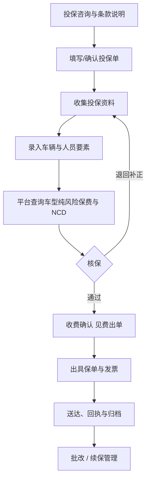

# 车险承保资料汇编

- **英文题名**：Auto Insurance Underwriting · Reference Pack
- **副标题**：监管制度、示范条款与费率机制、承保作业实务、2026 年最新动态，以及可直接获取的原文索引。
- **整理日期**：2026-11-17
- **适用范围**：中国大陆机动车辆保险
- **资料来源**：金融监管总局、中国政府网、中国保险行业协会等公开渠道
- **文档数**：12 份核心文件

## 一、文档地图：承保需要哪几类文件

车险承保的知识体系可以拆成四层：监管制度定规则，示范条款定责任，费率机制定价格，承保实务定操作。以下文档按这四层归类，后文逐层提炼要点。

| 层次 | 核心文档 | 发布主体 | 承保关注点 |
| --- | --- | --- | --- |
| **监管制度** | 车险综合改革指导意见（2020）；交强险条例；交强险限额与费率浮动公告；新能源车险高质量发展指导意见（2025） | 国务院、银保监会、金融监管总局等 | 强制承保义务、条款费率监管、费用与手续费上限、拒保红线 |
| **条款** | 机动车商业保险示范条款（2020 版）；新能源汽车商业保险示范条款（试行） | 中国保险行业协会 | 保险责任、责任免除、主险与附加险组合、特殊车型适配 |
| **费率** | 行业纯风险保费表、无赔款优待优化方案（2020 版）、交强险费率浮动方案 | 中保协、精算师协会、银保信平台 | 基准保费、NCD、交通违法系数、自主定价系数、车型系数 |
| **实务** | 机动车商业保险承保实务要点；车险承保理赔实务指南（2026 版） | 中保协、行业机构 | 告知说明、投保单录入、核保、见费出单、单证与批改 |

| 数据 | 说明 |
| --- | --- |
| 18 万元 | 交强险有责死亡伤残赔偿限额，2020 年 9 月 19 日起执行 |
| 25% | 商业车险附加费用率上限，由改革前的 35% 下调 |
| 0.5 – 2.0 | 现行无赔款优待系数区间，共 10 个等级 |

## 二、监管制度：承保环节的硬约束

### 2.1 车险综合改革指导意见（2020）

**《关于实施车险综合改革的指导意见》** · 中国银保监会 · 2020-09-02 印发 · 2020-09-19 施行

本轮车险改革的总纲，条款、费率、产品准入、监管方式均由此确定，是理解现行车险承保规则的起点。[1][2]

#### 承保直接相关的改革内容

- **保障范围扩展**：车损险主险在原有责任上并入全车盗抢、玻璃单独破碎、自燃、发动机涉水、不计免赔率、无法找到第三方特约等责任；支持开发车轮单独损失险、医保外用药责任险等附加险。
- **附加费用率下调**：商业车险附加费用率上限由 35% 降至 25%，预期赔付率由 65% 提高到 75%。
- **自主定价系数分步放开**：第一步将自主渠道系数与自主核保系数合并为自主定价系数，范围确定为 [0.65, 1.35]，后续适时完全放开。
- **无赔款优待优化**：赔付记录考察范围由前 1 年扩大到至少前 3 年，降低偶然赔付消费者的费率上调幅度。
- **产品准入调整**：发布新的交强险产品和商车险示范产品，商车险示范产品准入由审批制改为备案制。
- **监管配套**：建立条款费率备案细则、费率回溯规则、保费不足准备金制度、停止使用条款费率机制和车险经营回避制度。

> **对承保岗位的含义**
>
> 核保时不再单独使用"渠道系数 + 核保系数"，而是统一体现在自主定价系数内；出单系统必须回传并使用行业平台返回的车型纯风险保费与 NCD，人工不得自行调整。

### 2.2 交强险制度：强制承保与统一限额

**《机动车交通事故责任强制保险条例》** · 国务院令第 462 号 · 2006 年公布 · 2012 年国务院令第 618 号修订

确立交强险的强制投保、赔偿对象、责任限额与监管框架。保险公司不得拒绝或拖延承保交强险，这是承保环节最刚性的合规要求。[3]

- **投保义务**：境内道路上行驶的机动车所有人或管理人，应当依法投保交强险。
- **赔偿对象**：本车人员、被保险人以外的受害人的人身伤亡和财产损失，在责任限额内赔偿。
- **经营资格**：保险公司经监管机构批准，方可从事交强险业务。
- **费率与限额**：实行全国统一的基础保费和责任限额，费率浮动与道路交通事故记录挂钩。
- **条款文本**：交强险条款统一规定责任限额、垫付与追偿、赔偿处理等内容，承保与理赔共用同一份条款。[9]

#### 现行交强险责任限额（2020-09-19 起）

| 情形 | 死亡伤残赔偿限额 | 医疗费用赔偿限额 | 财产损失赔偿限额 |
| --- | --- | --- | --- |
| **被保险人有责任** | 180,000 元 | 18,000 元 | 2,000 元 |
| **被保险人无责任** | 18,000 元 | 1,800 元 | 100 元 |

#### 交强险费率浮动方案（A–E 五套，按地区执行）

最终保费 = 基础保费 ×（1 + 浮动比率 X）。X 取所在地区方案 A–E 中的一项，**各项不累加，同时满足多个因素时就高取值**。[4]

| 浮动因素 | A 方案 | B 方案 | C 方案 | D 方案 | E 方案 |
| --- | --- | --- | --- | --- | --- |
| 上一年度未发生有责任道路交通事故 | -30% | -25% | -20% | -15% | -10% |
| 上两个年度未发生有责任道路交通事故 | -40% | -35% | -30% | -25% | -20% |
| 上三个及以上年度未发生有责任道路交通事故 | -50% | -45% | -40% | -35% | -30% |
| 上一年度发生一次有责任不涉及死亡的事故 | 0% | 0% | 0% | 0% | 0% |
| 上一年度发生两次及以上有责任事故 | +10% | +10% | +10% | +10% | +10% |
| 上一年度发生有责任道路交通死亡事故 | +30% | +30% | +30% | +30% | +30% |

地区归属：A 为内蒙古、海南、青海、西藏；B 为陕西、云南、广西；C 为甘肃、吉林、山西、黑龙江、新疆；D 为北京、天津、河北、宁夏；E 为其余 20 个地区（含江苏、浙江、上海、广东、深圳等）。[4]

### 2.3 新能源车险高质量发展指导意见（2025）

**《关于深化改革加强监管促进新能源车险高质量发展的指导意见》** · 金融监管总局、工信部、交通运输部、商务部 · 金发〔2025〕4 号 · 2025-01-13

在车险综改基础上针对新能源汽车的专门政策，直接影响新能源车的承保政策、定价与产品形态。[5]

- **降低维修使用成本**：推动"三电系统"配件供给与维修标准建设，降低全生命周期使用成本。
- **车型风险分级**：研究建立保险车型风险分级制度，综合考虑低速碰撞结果、易损件价格、维修工时，**推动分级结果与商业车险保费挂钩**。
- **高赔付风险分担**：建立高赔付风险分担机制和平台，实现消费者愿保尽保，并在该机制内优化自主定价系数浮动范围。
- **优化定价**：合理优化新能源商业车险自主定价系数浮动范围；新车型定价综合考虑售价、续航、动力性能、安全配置与车型风险分级。
- **产品创新**：研究"基本 + 变动"组合产品，支持新能源网约车按实际运营情况灵活投保；探索"车电分离"模式商业车险产品。
- **监管要求**：强化新能源车险"报行合一"，压降不合规不合理费用；合理设定本地区自主定价系数均值、手续费率上限；**对拒保或拖延承保交强险的行为依法严肃查处**。

> **承保提示**
>
> 新能源车承保需同时满足两套规则：专属条款（责任范围）与新能源费率方案（定价、系数区间）。营运性质的新能源车（网约车）是核保与定价的高风险重点，需核实实际使用性质与运营数据。

## 三、条款与费率：保什么、怎么定价

### 3.1 机动车商业保险示范条款（2020 版）

**《中国保险行业协会机动车商业保险示范条款（2020 版）》** · 中国保险行业协会 · 2020 版 · 条款编码 BXMC2020AI0101

现行商业车险的基础条款文本，分为主险与附加险，投保人可选择投保全部或部分主险。[6]

#### 三个独立主险

- 机动车损失保险
- 机动车第三者责任保险
- 机动车车上人员责任保险

#### 车损险主险已并入的责任

2020 版将原属附加险的 **全车盗抢、玻璃单独破碎、自燃、发动机涉水、不计免赔率、无法找到第三方特约** 并入车损险主险责任，同时删除了原条款中的事故责任免赔率。这意味着承保时无需再单独加保这些附加险，但车损险的基准纯风险保费相应调整。

#### 附加险（按需组合）

投保相应主险后方可投保对应附加险，常见包括：附加绝对免赔率特约条款、附加车轮单独损失险、附加新增加设备损失险、附加车身划痕损失险、附加修理期间费用补偿险、附加发动机进水损坏除外特约条款、附加车上货物责任险、附加精神损害抚慰金责任险、附加法定节假日限额翻倍险、附加医保外用药责任险、附加机动车增值服务特约条款。[6]

#### 承保必须提示的责任免除

- **车辆状态变化**：被保险机动车被转让、改装、加装或改变使用性质等，导致危险程度显著增加且未及时通知保险人，因危险程度显著增加而发生的事故，保险人不负责赔偿。
- **车损险不赔项**：车轮单独损失、无明显碰撞痕迹的车身划痕、新增加设备损失（未投保对应附加险时）。
- **三者险与车上人员险**：同样适用车辆状态变化导致危险程度显著增加的免责约定。

> **实务关联**
>
> 家用车长期从事网约车运营、私自改装动力或车身结构，是拒赔高发场景。承保时如实记录使用性质、核对车辆改装情况，比事后争议更有效。

### 3.2 新能源汽车商业保险示范条款（试行）

**《新能源汽车商业保险示范条款（试行）》及《新能源汽车驾乘人员意外伤害保险示范条款（试行）》** · 中国保险行业协会 · 2021-12-14 发布 · 含两份示范条款

新能源车专属条款体系，与 2020 版商业车险条款并行，按车辆能源类型强制分流适用。[7]

- **适用规则**：所有新保和续保的新能源汽车，**统一适用新能源示范条款，不再适用 2020 版机动车商业保险示范条款**；摩托车、拖拉机、特种车除外；非新能源汽车不得适用新能源条款。
- **车损险责任扩展**：因自然灾害、意外事故（含起火燃烧）造成的车身、电池及储能系统、电机及驱动系统、其他控制系统的直接损失，纳入新能源汽车损失保险责任。
- **第三者责任**：新能源汽车第三者责任保险同样覆盖起火燃烧等新能源特有风险场景。
- **专属附加险**：围绕充电场景设置附加外部电网故障损失险、附加自用充电桩损失险、附加自用充电桩责任险等，另有增值服务类特约条款。

### 3.3 费率构成：从基准保费到实收保费

商业车险保费的基本结构在车险综改后保持稳定，变化在于系数的合并与浮动区间的放开。[14][10]

```text
商业车险保险费 = 基准保费 × 费率调整系数
基准保费 = 基准纯风险保费 ÷ (1 − 附加费用率)
费率调整系数 = 无赔款优待系数(NCD) × 交通违法系数 × 自主定价系数
```

| 要素 | 来源 | 承保操作要求 |
| --- | --- | --- |
| **基准纯风险保费** | 中保协统一制定，经车险信息平台返回 | 按行驶证厂牌型号准确录入，据实使用平台返回值，不得修改以调整保费 |
| **附加费用率** | 公司报备，上限 25% | 产品备案确定，承保端不得突破 |
| **NCD 系数** | 行业平台按近三年投保及出险记录计算 | 直接取平台返回值，严禁人工上浮或下调 |
| **交通违法系数** | 已与交管平台对接的地区由平台返回 | 未对接地区返回 1.0，不得自行调整 |
| **自主定价系数** | 公司自主定价，综改第一步区间 [0.65, 1.35] | 落实"报行合一"，实际使用与报备一致；地区均值受监管回溯 |
| **车型系数** | 行业按赔付率、出险频度、零整比划分档位 | 新保、转保依据合格证、行驶证、发票或进口证明录入车型 |

短期险保费按实际承保天数折算；采用见费出单的地区，保单须在保费全额入账确认后方可出具。

### 3.4 无赔款优待（NCD）优化方案

**《机动车商业保险无赔款优待优化方案（2020 版）》** · 中国保险行业协会 · 2020 版 · 现行行业方案

改革后 NCD 由原来按上年出险情况浮动，改为按近三年投保与赔付记录确定等级，共 10 个等级，系数区间 0.5–2.0。[8][16]

| NCD 等级 | -4 | -3 | -2 | -1 | 0 | 1 | 2 | 3 | 4 | 5 |
| --- | --- | --- | --- | --- | --- | --- | --- | --- | --- | --- |
| **系数** | 0.5 | 0.6 | 0.7 | 0.8 | 1.0 | 1.2 | 1.4 | 1.6 | 1.8 | 2.0 |

等级根据连续投保年限、近三年出险次数、过户与断保等情况综合计算，具体等级由行业车险信息平台返回。长期无赔可降至 -4 级（0.5），多次出险可升至 5 级（2.0）。承保时应向客户说明：**小额案件理赔会影响后续等级与保费**，这是续保沟通的关键点。

## 四、承保实务：从投保单到保单

以下流程与操作规范综合行业承保实务要点整理，各地监管局与保险公司会有细化规定，实际执行以属地规则和公司作业手册为准。[10]

### 4.1 标准作业流程



*图 1：车险承保标准作业流程*

### 4.2 投保资料要求

| 业务类型 | 所需资料 | 说明 |
| --- | --- | --- |
| **新保 / 转保** | 投保人身份证明、行驶证复印件 | 核对车辆所有人、使用性质、厂牌型号与证件一致 |
| **新车未上牌** | 购车发票复印件或出厂合格证复印件 | 取得正式号牌后应书面通知保险人办理批改 |
| **续保** | 人员及车辆证件在有效期内且信息未变时，可不再重复提供 | 信息发生变化时仅补充变更部分 |
| **营运 / 特种车** | 道路运输证、营运资质、车辆登记信息等 | 使用性质与证件必须匹配，避免按非营运低价承保 |
| **新能源车** | 行驶证、车辆登记信息（含能源类型） | 确认适用新能源专属条款，核对电池与车辆型号 |

### 4.3 投保单要素与录入规范

- **必录要素**：号牌号码（或临时号牌）、机动车种类、使用性质、发动机号、车架号/VIN、厂牌型号、排量、功率、登记日期、核定载客人数或载质量，以及投保人、被保险人的姓名/名称、证件号码、住所与联系方式。
- **号牌格式**：由汉字、大写字母、阿拉伯数字组成，录入时不得添加点、杠、斜杠等符号；未上牌新车按当地交管规则录入。
- **厂牌型号**：必须按行驶证载明的厂牌型号准确录入。**车型直接决定车损险纯风险保费，不得通过改变车型提高或降低保费**。
- **保险期间**：通常为 1 年；起保时点必须在保险人接受投保申请且确认全额保费入账之后，见费出单地区不得倒签起期。
- **承保险别**：严格按投保人勾选的险种录入保额、责任限额及是否投保附加险，不得擅自赠送附加险。
- **特别约定**：只能对未详尽事项作补充，不得与条款相悖、不得缩小或扩大保险责任。

### 4.4 核保关注要点

- **使用性质真实性**：家用车从事网约车、租赁、货运等营运活动，属于危险程度显著增加，须按实际性质承保或明确告知拒赔后果。
- **车型准确性**：核对行驶证、合格证、发票与系统车型库，防止高配低录、错录车型套用低费率。
- **车损险保额协商**：协商实际价值应尽量贴近行业参考实际价值，实务要点提出偏离幅度原则上不超过上下 30%，避免全损时不当得利或投诉。
- **历史赔付与过户**：关注近三年出险记录、过户次数、断保情况，NCD 以平台返回值为准。
- **验车验标**：转保、断保后投保车损险、老旧高端车型、结构特殊车型，应按公司规定见车验车，拍摄车架号并留存影像。
- **特殊车辆**：临时号牌/提车业务适用单程提车保险；特种车、摩托车、拖拉机适用对应条款与费率表，不得混用。
- **新能源车**：核实是否包含电池及储能系统、是否为换电或车电分离模式，按专属条款与新能源费率方案承保。
- **交强险不得拒保**：对拒保或拖延承保交强险的行为，监管明确依法查处，这是不可触碰的红线。

### 4.5 条款说明与销售可回溯

- 向投保人提供投保单并附条款，说明保险责任、保险金额、责任免除、投保人与被保险人义务、赔偿处理。
- 免责条款须在投保单上作出足以引起注意的提示，并通过投保提示书或免责事项说明书明确说明。
- 投保人应在投保提示书上手书确认"已收到条款及免责事项说明书、保险人已说明免责条款含义及法律后果"并签名。
- 电销渠道以录音记录投保需求；网销渠道在确认身份后展示条款与免责说明，投保人点选确认后方可进入后续流程。
- 对保障范围较低的产品或非现场投保场景，按监管要求以音频、视频形式记录说明过程，相关资料纳入核保要件并在规定期限内保存。

### 4.6 收费、单证、批改与退保

- **见费出单**：系统在确认全额保费入账后生成唯一有效指令，方可出具正式保单；已起保后退保按条款收取短期保费。
- **单证管理**：保单须由业务系统出具，禁止手工出单；保单正本交投保人或被保险人，业务与财务留存联按公司规定归档；保险凭证加盖业务专用章。
- **批改**：车辆过户、使用性质变更、号牌变更、新增设备等应及时办理批改；车辆转让的，受让人承继权利义务，危险程度显著变化的，保险人可调整保费或解除合同。
- **退保**：商业险合同解除时，投保人应交回保单正本核销，按短期费率计算应退保费。
- **续保管理**：提前核对上年保单信息与出险记录，避免因断保导致 NCD 等级与验车要求变化。

## 五、2026 年最新动态

**《车险承保理赔实务指南（2026 版）》** · 中国保险行业协会 · 2026-08-21 印发

面向全行业统一承保理赔实操口径的最新指南。修订聚焦行业实操痛点与机构执行尺度差异，明确人身损害赔偿流程标准，健全矛盾纠纷化解路径，强化消费者知情权、自主选择权和公平交易权保护。下一步将组织全行业宣贯培训，并动态优化实务标准。[11]

**《智能网联新能源汽车商业保险示范条款（试点地区）》** · 中国保险行业协会 · 2026-11 常务理事会审议通过

与定期寿险示范条款（2026 年修订）等共五项示范条款及配套使用说明一并审议通过，标志智能网联汽车专属车险产品进入试点落地阶段。[12]

**北京率先启动智能网联新能源汽车商业保险开发应用** · 北京金融监管局 · 2026-03-29

专属产品在现有新能源车险基础上优化升级，统一适配 L2 至 L4 全级别智能网联新能源汽车，首次对"人机共驾"乃至"机驾"场景下的风险保障作出制度性安排。[13]

> **影响判断**
>
> 智能网联车险的承保要素将从"车 + 人"扩展到"车 + 人 + 系统"，涉及智驾等级、软件版本、数据记录等新型核保因子。建议持续跟踪试点地区条款与费率方案，提前梳理系统改造与数据采集需求。

## 六、原文获取清单

以下为可直接访问的公开原文或官方发布页，建议归档时同时保存文号与发布日期，条款全文以中保协及保险公司官网发布的正式版本为准。[15]

| 序 | 文档 | 发布主体 / 时间 | 类型 | 获取地址 |
| --- | --- | --- | --- | --- |
| 1 | 关于实施车险综合改革的指导意见 | 银保监会 / 2020-09-02 | 监管文件 | [中国政府网](https://www.gov.cn/zhengce/zhengceku/2020-09/04/content_5540321.htm) |
| 2 | 车险综合改革指导意见答记者问 | 银保监会 / 2020-09 | 政策解读 | [金融监管总局](https://www.nfra.gov.cn/cn/view/pages/ItemDetail.html?docId=926440&itemId=915&generaltype=0) |
| 3 | 机动车交通事故责任强制保险条例 | 国务院 / 2012 修订 | 行政法规 | [中国政府网](https://www.gov.cn/zhengce/2012-04/30/content_2602601.htm) |
| 4 | 关于调整交强险责任限额和费率浮动系数的公告 | 银保监会 / 2020-09-09 | 监管公告 | [金融监管总局](https://www.nfra.gov.cn/cn/view/pages/ItemDetail.html?docId=928013&itemId=925&generaltype=0) |
| 5 | 关于深化改革加强监管促进新能源车险高质量发展的指导意见 | 金融监管总局等四部门 / 2025-01-13 | 监管文件 | [中国政府网](https://www.gov.cn/zhengce/zhengceku/202501/content_7001024.htm) |
| 6 | 机动车商业保险示范条款（2020 版）全文 | 中保协 / 2020 | 示范条款 | [条款全文 PDF](https://property.cic.cn/u/cms/zhcaixian/202009/18183136legw.pdf) |
| 7 | 新能源汽车商业保险专属条款（试行）发布通知及附件 | 中保协 / 2021-12-14 | 示范条款 | [中保协（含 Word 附件）](https://www.iachina.cn/art/2021/12/14/art_24_105694.html) |
| 8 | 机动车商业保险无赔款优待优化方案（2020 版） | 中保协 / 2020 | 费率方案 | [中保协（Word 下载）](https://www.iachina.cn/art/2024/1/25/art_94_107394.html) |
| 9 | 机动车交通事故责任强制保险条款 | 行业条款 | 条款文本 | [条款全文 PDF](https://property.picc.com.cn/fuwu/cxbxtk/201909/P0202208031659505083.pdf) |
| 10 | 机动车商业保险承保实务要点（试点地区试行版） | 行业实务文件 | 实务规范 | [实务要点 PDF](https://www.95590.cn/ebiz/view/download/YaoDian.pdf) |
| 11 | 车险承保理赔实务指南（2026 版）发布消息 | 中保协 / 2026-08-21 | 行业指南 | [中保协发布页](https://www.iachina.cn/art/2026/8/21/art_22_109243.html) |
| 12 | 中保协常务理事会审议通过五项示范条款 | 中保协 / 2026-11 | 行业动态 | [报道链接](https://finance.sina.com.cn/jjxw/2026-11-16/doc-iniyxuex2318804.shtml) |

> **使用说明**
>
> 第 6、9、10 项为第三方站点转载的条款与实务 PDF，内容与行业发布版本一致但版式可能不同；正式引用或对外交付时，建议以中保协官网及承保公司官网发布版本为准。第 11 项为发布消息，2026 版指南全文目前未在公开渠道发布。

## 参考来源

1. 中国银保监会，《关于实施车险综合改革的指导意见》，2020-09-02。[原文链接](https://www.gov.cn/zhengce/zhengceku/2020-09/04/content_5540321.htm)
2. 中国银保监会有关部门负责人就《关于实施车险综合改革的指导意见》答记者问。[原文链接](https://www.nfra.gov.cn/cn/view/pages/ItemDetail.html?docId=926440&itemId=915&generaltype=0)
3. 国务院，《机动车交通事故责任强制保险条例》（2012 年修订）。[原文链接](https://www.gov.cn/zhengce/2012-04/30/content_2602601.htm)
4. 中国银保监会，《关于调整交强险责任限额和费率浮动系数的公告》，2020-09-09。[原文链接](https://www.nfra.gov.cn/cn/view/pages/ItemDetail.html?docId=928013&itemId=925&generaltype=0)
5. 金融监管总局、工信部、交通运输部、商务部，《关于深化改革加强监管促进新能源车险高质量发展的指导意见》，金发〔2025〕4 号。[原文链接](https://www.gov.cn/zhengce/zhengceku/202501/content_7001024.htm)
6. 中国保险行业协会，《机动车商业保险示范条款（2020 版）》全文（转载 PDF）。[原文链接](https://property.cic.cn/u/cms/zhcaixian/202009/18183136legw.pdf)
7. 中国保险行业协会，《关于发布〈中国保险行业协会新能源汽车商业保险专属条款（试行）〉的通知》，2021-12-14。[原文链接](https://www.iachina.cn/art/2021/12/14/art_24_105694.html)
8. 中国保险行业协会，《机动车商业保险无赔款优待优化方案（2020 版）》。[原文链接](https://www.iachina.cn/art/2024/1/25/art_94_107394.html)
9. 机动车交通事故责任强制保险条款全文（人保财险官网 PDF）。[原文链接](https://property.picc.com.cn/fuwu/cxbxtk/201909/P0202208031659505083.pdf)
10. 《机动车商业保险承保实务要点（试点地区试行版）》，行业承保操作实务文件。[原文链接](https://www.95590.cn/ebiz/view/download/YaoDian.pdf)
11. 中国保险行业协会，《车险承保理赔实务指南（2026 版）》印发消息，2026-08-21。[原文链接](https://www.iachina.cn/art/2026/8/21/art_22_109243.html)
12. 中国保险行业协会召开第六届常务理事会第六次会议，审议通过智能网联新能源汽车商业保险示范条款（试点地区）等五项示范条款。[原文链接](https://finance.sina.com.cn/jjxw/2026-11-16/doc-iniyxuex2318804.shtml)
13. 央视网，《北京启动智能网联新能源汽车商业保险开发应用》，2026-03-29。[原文链接](https://news.cctv.com/2026/03/29/ARTIFWuNJXV2Blz70YKV4sxr260329.shtml)
14. 上海市委金融办，《车险综合改革实施在即 条款费率调整方案出炉》，2020-09-11。[原文链接](https://jrj.sh.gov.cn/ZXYW178/20200911/9d2ff984936c4d3e844fa2db174899f4.html)
15. 中国保险行业协会，“条款费率”栏目，车险相关示范条款与文件发布入口。[原文链接](https://www.iachina.cn/col/col38/index.html)
16. 太平洋财产保险，《车险报案是否会影响续保保费》——NCD 等级与系数对照。[原文链接](https://www.cpic.com.cn/c/2022-09-22/1635836.shtml)

---

说明：本文档为公开资料整理，用于业务学习与内部参考，不构成保险条款解释或法律意见。条款责任以保险合同约定为准，费率与承保规则以监管机构及承保公司最新发布版本为准。
