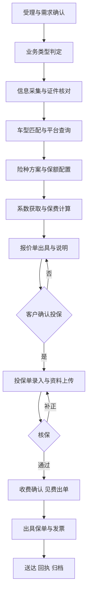

# 车险报价与出单操作手册

- 版本：V1.2
- 编制日期：2026-11-17
- 变更记录：V1.1 新增第 7 章核保规则（硬性校验、人工核保触发、条件承保、拒保边界、质检与版本管理）；V1.2 引用《车险责任与条款速查》配套文档
- 适用范围：家庭自用车、非营业/营业客车、货车、特种车、新能源汽车的新保、转保、续保报价与出单作业
- 配套文档：《车险承保资料汇编》（同目录 auto-insurance-underwriting-docs.html）、《车险责任与条款速查》（同目录 车险责任与条款速查.md）、《车险理赔操作手册与条款》（同目录 车险理赔操作手册与条款.md）
- 使用说明：本手册为通用作业规范，具体系统字段、审批权限、属地费率方案以本公司作业手册和当地监管要求为准

---

## 1. 目的

统一报价与出单两个环节的操作步骤、信息口径和校验规则，做到：

1. 报价所用车辆信息、险种方案、系数与最终保单一致；
2. 每一张保单都能追溯到资料、核保意见、收费凭证和客户确认记录；
3. 常见阻断在报价阶段发现，不带病进入出单；
4. 不触碰合规红线（拒保交强险、手工出单、倒签起期、擅自改车型或系数）。

---

## 2. 岗位与职责

| 岗位 | 主要职责 | 关键产出 |
|---|---|---|
| 报价岗 | 采集信息、判定业务类型、配置险种、系统报价、向客户说明 | 报价单、客户需求确认记录 |
| 核保岗 | 规则校验、人工核保、特约与条件承保审批 | 核保意见、核保结论 |
| 收费/出单岗 | 收费确认、出具保单与发票、送达 | 收费凭证、保单、发票 |
| 单证管理岗 | 单证领用、核销、归档、回执管理 | 单证台账、归档影像 |

原则：核保与收费不得由同一人越权操作；系统自动核保通过的规则不得人工绕过。

---

## 3. 全流程总览



| 阶段 | 关键动作 | 输出 | 常见阻断 |
|---|---|---|---|
| 受理 | 确认投保人、被保险人、车辆、使用性质 | 需求记录 | 使用性质与实际不符 |
| 报价 | 车型匹配、险种配置、系数取数 | 报价单 | 车型无法匹配、平台不可用 |
| 录单 | 投保单录入、影像上传 | 待核保任务 | 证件过期、信息缺项 |
| 核保 | 自动核保、人工核保 | 核保结论 | 高风险车型、营运性质、历史赔付异常 |
| 收费 | 见费出单、支付确认 | 收费凭证 | 支付失败、金额与报价不一致 |
| 出单 | 保单、发票、送达 | 保单、发票、回执 | 单证库存、电子签名失败 |
| 归档 | 影像与回执归档 | 业务档案 | 资料缺失 |

---

## 4. 报价前准备

### 4.1 确认条款与费率版本

| 车辆类型 | 适用条款 | 费率方案 |
|---|---|---|
| 非新能源汽车 | 机动车商业保险示范条款（2020 版） | 属地商业车险费率方案 |
| 新能源汽车（不含摩托车、拖拉机、特种车） | 新能源汽车商业保险示范条款（试行） | 新能源商业车险费率方案 |
| 摩托车、拖拉机、特种车 | 对应车型条款 | 对应费率表 |
| 未上牌新车短途移动 | 单程提车保险条款 | 单程提车费率 |

要点：新能源车不得套用 2020 版机动车商业保险示范条款；非新能源车不得套用新能源条款。

### 4.2 系统与平台检查

- 车险信息平台可查询车型纯风险保费、NCD、交通违法系数；
- 车型库可检索行驶证厂牌型号；
- 支付渠道、电子保单签发、发票开具服务正常；
- 单证库存满足需要（纸质保单场景）。

平台不可用时不得手工估价出单，按第 10 节处理。

### 4.3 信息采集清单

| 类别 | 必采信息 |
|---|---|
| 人员 | 投保人姓名/名称、证件类型与号码、联系方式、地址；被保险人（可与投保人不同） |
| 车辆 | 号牌号码（或临时号牌）、厂牌型号、车架号/VIN、发动机号、登记日期、使用性质、车辆种类、核定载客人数或载质量、排量/功率、能源类型 |
| 历史 | 上年保单号、承保公司、近三年出险与赔付记录、是否过户、是否断保 |
| 需求 | 投保险种、车损险保额、三者险责任限额、每座限额、附加险选择、保险期间、缴费方式 |

### 4.4 客户需求确认

- 保障范围：只保交强险，或交强险 + 商业险；
- 预算区间与可接受的免赔安排；
- 使用性质：家庭自用、非营业、营业（网约车、租赁、货运等）；
- 是否接受绝对免赔率特约等降费方案；
- 保险期间起止要求。

使用性质、车辆用途必须由客户确认并留痕，不得由销售人员代为判断。

---

## 5. 报价作业

### 5.1 判定业务类型

| 判断项 | 分支 | 后续动作 |
|---|---|---|
| 是否首次投保 | 新保 | 全量采集信息，核对购车发票或合格证 |
| 上年是否在本公司 | 续保 | 调取上年保单，核对变更项 |
| 上年在他司 | 转保 | 按新保采集，核实上年保单与出险记录 |
| 是否断保 | 断保 | 按公司规定验车，重新核保 |
| 是否新能源 | 是 | 切换新能源条款与费率 |
| 是否营运 | 是 | 核验营运资质，按营运性质报价 |

### 5.2 车辆信息核对

逐项比对行驶证（或合格证、购车发票、进口证明）：

- 号牌号码与行驶证一致，录入不加点、杠、斜杠；
- 厂牌型号按行驶证原文录入，不做简写或近似替换；
- 车架号 17 位逐位核对，注意 0/O、1/I；
- 发动机号、登记日期、核定载客/载质量与证件一致；
- 使用性质与行驶证一致；
- 新能源车确认能源类型与是否换电模式。

### 5.3 使用性质与车辆种类判定

| 常见错误 | 后果 | 正确做法 |
|---|---|---|
| 家用车按非营运投保，实际跑网约车 | 危险程度显著增加，事故可能拒赔 | 按实际营运性质承保或明确告知拒赔风险 |
| 营业货车按非营业投保 | 费率偏低、核保失真 | 核验道路运输证，按营业性质投保 |
| 客车座位数录错 | 车上人员责任险保额与保费错误 | 按核定载客人数录入 |
| 特种车按普通客车投保 | 条款与费率双重错误 | 按特种车条款与费率表承保 |

### 5.4 车型匹配与纯风险保费查询

1. 以行驶证厂牌型号在车型库检索；
2. 核对企业名称、型号代码、座位数、排量/功率、上市年份；
3. 从车险信息平台获取车型纯风险保费，系统自动带入，不得修改；
4. 多款近似车型并存时，以证件信息唯一匹配的车型为准，不得选低保费车型；
5. 匹配失败：提交车型新增或人工核保，保留证件影像与匹配说明，禁止随意选择近似车型继续报价。

### 5.5 险种方案配置

交强险：法定必保，不得拒保或拖延承保。

商业险主险与附加险的依赖关系：

| 险种 | 类型 | 投保前提 | 说明 |
|---|---|---|---|
| 机动车损失保险 / 新能源汽车损失保险 | 主险 | 无 | 2020 版已并入盗抢、玻璃、自燃、涉水、不计免赔、无法找到第三方责任 |
| 机动车第三者责任保险 | 主险 | 无 | 可附加医保外用药责任险、法定节假日限额翻倍险等 |
| 机动车车上人员责任保险 | 主险 | 无 | 分司机座与乘客座，按座位数投保 |
| 附加绝对免赔率特约条款 | 附加险 | 投保对应主险 | 约定免赔率，保费相应下降，须向客户明确 |
| 附加车轮单独损失险 | 附加险 | 投保车损险 | 覆盖无其他部位损失的车轮单独损坏 |
| 附加车身划痕损失险 | 附加险 | 投保车损险 | 按保额档次选择 |
| 附加新增加设备损失险 | 附加险 | 投保车损险 | 需列明设备明细与金额 |
| 附加修理期间费用补偿险 | 附加险 | 投保车损险 | 约定补偿天数与日限额 |
| 附加发动机进水损坏除外特约条款 | 附加险 | 投保车损险 | 选择后涉水损失不赔，保费下降 |
| 附加车上货物责任险 | 附加险 | 投保三者险或车上人员险（按条款） | 货车场景常用 |
| 附加精神损害抚慰金责任险 | 附加险 | 投保三者险或车上人员险 | 按条款约定限额 |
| 附加法定节假日限额翻倍险 | 附加险 | 投保三者险 | 节假日三者限额翻倍 |
| 附加医保外用药责任险 | 附加险 | 投保三者险或车上人员险 | 覆盖医保外用药费用 |
| 附加机动车增值服务特约条款 | 附加险 | 按条款 | 道路救援等服务，注意服务次数与范围 |
| 新能源专属：外部电网故障损失险、自用充电桩损失险、自用充电桩责任险 | 附加险 | 投保新能源车损险/三者险 | 核实是否固定车位、充电桩权属 |

禁止：向客户赠送未投保的附加险；以特别约定扩大或缩小条款责任。

### 5.6 保额与责任限额确定

| 项目 | 确定方式 | 注意点 |
|---|---|---|
| 车损险保额 | 按投保时车辆实际价值与客户协商确定 | 尽量贴近行业参考实际价值，偏离过大易引发全损争议；不得通过压低保额变相降费 |
| 三者险责任限额 | 按公司报备档位选择 | 常见档位从 10 万至 1000 万，营运及新能源车建议更高限额 |
| 车上人员每座限额 | 按座位分别约定 | 司机座与乘客座分别录入，乘客座按投保座位数计算 |
| 附加险保额/限额 | 按条款与客户约定 | 划痕险按档次、修理补偿按天数和日限额 |
| 新能源车损险 | 覆盖车身、电池及储能系统、电机及驱动系统、其他控制系统 | 换电车型需确认电池权属与投保方式 |

### 5.7 系数获取与使用

| 系数 | 来源 | 操作要求 |
|---|---|---|
| NCD 无赔款优待系数 | 行业车险信息平台按近三年记录返回 | 直接使用返回值，严禁人工上浮或下调 |
| 交通违法系数 | 已对接交管平台地区由平台返回，未对接地区为 1.0 | 不得自行设定 |
| 自主定价系数 | 公司报备方案 | 按公司规则取数，实际使用与报备一致，不得口头承诺额外折扣 |
| 车型系数 | 已包含在平台返回的纯风险保费中 | 通过准确录入车型体现，不得修改 |

NCD 等级区间为 0.5–2.0，共 10 级。向客户说明时使用平台返回的等级与系数，不自行推算。

### 5.8 保费计算与核对

```text
商业车险保费 = 基准保费 × NCD × 交通违法系数 × 自主定价系数
基准保费 = 基准纯风险保费 ÷ (1 − 附加费用率)
交强险保费 = 基础保费 × (1 + 浮动比率)
```

示例（仅演示计算顺序，数值非真实报价）：

```text
基准保费 3,000 元
NCD 0.8 × 交通违法系数 1.0 × 自主定价系数 0.9
商业险保费 = 3,000 × 0.8 × 1.0 × 0.9 = 2,160 元
```

核对项：

- 各险种保费之和与合计一致；
- 交强险与商业险分别列示；
- 短期险按实际承保天数折算；
- 报价金额与系统试算金额一致，截图或保存报价记录。

### 5.9 报价单要素

| 区块 | 内容 |
|---|---|
| 头部 | 报价单号、报价时间、有效期、报价机构与经办人 |
| 客户 | 投保人、被保险人、联系方式 |
| 车辆 | 号牌、厂牌型号、车架号、使用性质、登记日期 |
| 方案 | 险种、保额/责任限额、是否附加绝对免赔率 |
| 价格 | 交强险保费、商业险保费、车船税（如代收）、合计 |
| 说明 | 条款名称与版本、免责提示、NCD 影响说明、报价有效期、以最终核保结论为准 |

### 5.10 报价说明要点

必须主动说明：

1. 适用条款名称与版本（2020 版或新能源试行版）；
2. 交强险责任限额与商业险保障范围；
3. 责任免除重点：车辆转让、改装、加装或改变使用性质导致危险程度显著增加且未通知的，因危险程度显著增加发生的事故不赔；
4. 车损险不赔车轮单独损失、无明显碰撞痕迹划痕等，需附加险补充；
5. 出险理赔会影响后续 NCD 等级与保费；
6. 选择绝对免赔率特约后，理赔时按约定免赔率扣减；
7. 报价有效期及超期需重新报价；
8. 最终保费以核保通过后的保单为准。

### 5.11 报价复核清单

- [ ] 业务类型判定正确（新保/转保/续保/断保）
- [ ] 条款版本与能源类型匹配
- [ ] 行驶证信息逐项核对，车型唯一匹配
- [ ] 使用性质与车辆用途一致，营运资质已核验
- [ ] 险种与附加险依赖关系正确
- [ ] 车损险保额、三者限额、每座限额符合客户确认
- [ ] NCD、交通违法、自主定价系数均来自系统，无人工修改
- [ ] 保费合计与系统试算一致
- [ ] 报价单要素完整，免责与 NCD 说明已告知
- [ ] 报价记录已保存

---

## 6. 出单作业

### 6.1 投保单录入

| 字段组 | 字段 | 校验 |
|---|---|---|
| 人员 | 投保人、被保险人姓名/名称、证件类型与号码、联系方式、地址 | 证件在有效期内；投保人与被保险人关系合理 |
| 车辆 | 号牌、厂牌型号、VIN、发动机号、登记日期、使用性质、车辆种类、核定载客/载质量 | 与证件影像一致；号牌格式合规 |
| 险种 | 险种代码、保额/责任限额、免赔约定、附加险 | 与报价方案一致；附加险前提满足 |
| 期间 | 起保日期与时点、终止日期 | 起保时点不早于投保申请与保费入账时点 |
| 其他 | 特别约定、争议解决方式、行驶区域 | 特别约定不与条款冲突 |

续保且信息未变更的，可引用上年保单信息，但仍需核对证件有效期与出险记录。

### 6.2 资料收集与影像上传

| 业务 | 必需资料 |
|---|---|
| 新保/转保 | 投保人身份证明、行驶证 |
| 新车未上牌 | 购车发票或出厂合格证；上牌后补办批改 |
| 续保 | 信息未变可免；变更项需补充证明 |
| 营运车 | 道路运输证、营运资质材料 |
| 过户车 | 新行驶证、登记证书 |
| 验车业务 | 车辆照片、车架号照片、验车记录 |

影像要求：清晰完整、四角可见、与录入信息一致；复印件附贴投保单背面并加盖骑缝章（纸质场景）。

### 6.3 提交核保

| 触发方式 | 适用情形 |
|---|---|
| 自动核保 | 信息完整、车型匹配、风险规则内、无历史异常 |
| 人工核保 | 营运性质、高风险车型、高保额、多次出险、过户、断保、验车业务、车型新增、特别约定 |
| 转核保 | 超出报价岗权限的费率或条件承保需求 |

提交前确认：报价方案与录入方案一致；资料齐全；客户已确认保费。硬性校验与人工核保触发条件见第 7 章。

### 6.4 核保意见处理

| 核保结论 | 处理动作 |
|---|---|
| 通过 | 进入收费环节 |
| 补正 | 一次性列明缺项，补齐后重新提交，不重复往返 |
| 加费/条件承保 | 向客户说明原因与新价格，取得确认后继续；客户不接受则终止 |
| 特约承保 | 特别约定经审批后录入，不得口头约定 |
| 商业险拒保 | 书面说明理由；交强险不得拒保 |

核保意见、客户确认记录与最终保单必须一并归档。核保结论的判定依据、风险阈值与条件承保工具见第 7 章。

### 6.5 收费确认与见费出单

1. 核对收费金额与核保通过金额一致（含交强险、商业险、代收车船税）；
2. 按公司支持的渠道收款，生成支付订单；
3. 系统确认全额保费入账后，生成唯一有效出单指令；
4. 见费出单地区，未确认收费不得出具正式保单；
5. 支付失败或金额不符时，订单不进入出单，查明原因后重试。

禁止：先出单后收费；倒签保险起期；以个人账户代收保费。

### 6.6 保单与发票出具

保单必须由业务系统出具，禁止手工出单。出具后校验：

- 保单号、投保单号、批单号关联正确；
- 投保人、被保险人、车辆信息与投保单一致；
- 险种、保额、限额、免赔约定与核保结论一致；
- 保险期间正确，起期不早于收费确认时点；
- 保费合计、发票金额与收费凭证一致；
- 条款名称与版本正确（新能源车为新能源示范条款）；
- 特别约定内容完整且经审批；
- 电子保单签章有效，纸质保单加盖业务专用章。

交强险与商业险同时承保的，可合并打印发票，但保单分别出具。

### 6.7 送达与回执

- 电子保单：发送至客户确认的手机号或邮箱，留存发送记录；
- 纸质保单：当面交付或邮寄，取得签收回执；
- 同时提供条款与免责事项说明；
- 告知报案电话、理赔流程与批改办理方式。

### 6.8 归档

归档清单：

- [ ] 投保单（含客户签名或电子确认记录）
- [ ] 身份证明、行驶证及其他资料影像
- [ ] 验车记录与照片（如适用）
- [ ] 报价单与客户确认记录
- [ ] 核保意见与审批记录
- [ ] 收费凭证
- [ ] 保单、发票、回执
- [ ] 特别约定与免责说明签收记录

### 6.9 出单复核清单

- [ ] 报价方案 = 投保单 = 核保结论 = 保单
- [ ] 交强险已承保，无拒保或拖延
- [ ] 车型、使用性质、座位数准确
- [ ] 起保时点合规，未见费不出单
- [ ] 保单号唯一，单证已登记核销
- [ ] 发票金额与收费一致
- [ ] 客户已收到保单、条款与免责说明
- [ ] 影像与回执已归档

---

## 7. 核保规则

核保规则分三层，冲突时上位优先：**监管强制规则 > 行业示范条款与实务 > 公司核保政策**。本章所列数值阈值为示例，公司应结合自身赔付数据、报备费率方案和属地监管要求配置，并以规则版本号管理；未配置前不得直接照搬。

依据：车险综合改革指导意见、交强险条例及限额公告、机动车商业保险示范条款（2020 版）、新能源汽车商业保险示范条款（试行）、车险承保理赔实务指南（2026 版）。

### 7.1 核保结论与权限

| 结论 | 含义 | 典型情形 | 审批权限 |
|---|---|---|---|
| 标准承保 | 按报备方案标准条件承保 | 信息完整、风险规则内 | 自动核保或初级核保 |
| 加费承保 | 在报备费率与系数区间内加费 | 出险次数偏多、车型风险偏高 | 高级核保 |
| 条件承保 | 以免赔、限额、指定驾驶员/区域、验车等条件承保 | 高龄车、高价值车、营运车、改装车 | 高级核保 |
| 暂缓承保 | 待补资料或验车后重新判定 | 证件缺失、车型待核实、需验车 | 初级核保 |
| 拒绝承保商业险 | 商业险不予承保，书面告知理由 | 违法改装、无营运资质、欺诈记录等 | 机构负责人或总公司 |
| 交强险 | **不得拒绝、不得拖延、不得搭售商业险** | 所有上路车辆 | 无审批空间 |

权限分离要求：报价岗只能试算与提交，不得自行核保；加费、条件承保、拒保必须由上一级权限审批；收费与核保操作不得由同一人越权完成。

### 7.2 硬性校验规则（自动核保必过项）

| 编号 | 校验规则 | 不通过时的处理 |
|---|---|---|
| B-01 | 交强险已投保或本次同时投保 | 阻断出单，提示补投交强险 |
| B-02 | 条款版本与能源类型匹配（新能源/非新能源） | 切换条款重新报价 |
| B-03 | 车型在车型库唯一匹配，且平台返回纯风险保费 | 转人工核保或车型新增，禁止近似选型 |
| B-04 | 必录字段完整：人员证件、号牌、VIN、发动机号、登记日期、使用性质、核定载客/载质量 | 退回补录，不得空项提交 |
| B-05 | 证件在有效期内，投保人/被保险人信息与证件一致 | 更新证件后重提 |
| B-06 | 使用性质、车辆种类为系统合法值，且与行驶证一致 | 修正后重提，禁止手工改写枚举值 |
| B-07 | 险种依赖关系成立（附加险均有对应主险） | 调整险种组合 |
| B-08 | 保额、责任限额在公司报备档位内 | 调整至合法档位 |
| B-09 | 起保时点不早于投保申请与保费入账时点 | 修正起期，禁止倒签 |
| B-10 | 同一车辆同一期间无重复有效交强险保单 | 终止重复承保，核对原保单 |
| B-11 | 收费金额与核保通过金额一致 | 重新试算或查明差额 |
| B-12 | 未命中公司反欺诈与黑名单规则 | 转反欺诈核查，暂缓承保 |

### 7.3 风险判定与人工核保触发

以下为风险维度与示例阈值，命中任一项即转人工核保，并记录命中的规则编号。

| 编号 | 风险维度 | 判定依据 | 示例阈值 | 常见处理 |
|---|---|---|---|---|
| R-01 | 车龄 | 登记日期至起保日期 | 车龄 ≥ 8 年转人工；≥ 10 年限制车损险保额或仅承保三者/座位 | 验车、按实际价值投保、提高免赔 |
| R-02 | 车型风险 | 行业车型系数、零整比、车型赔付率 | 车型系数处于最高档或零整比显著偏高 | 加费、限定维修厂、提高免赔 |
| R-03 | 历史赔付 | 近三年出险次数与赔付金额 | 近三年出险 ≥ 3 次，或单案赔付 ≥ 50 万元 | 加费、条件承保、转高级核保 |
| R-04 | 赔付率 | 该车或该客户历史赔付率 | 赔付率 > 100% | 加费或调整承保条件 |
| R-05 | 使用性质 | 行驶证、营运资质、平台运营数据 | 营运、网约车、租赁、货运 | 按营运性质定价，核验资质 |
| R-06 | 车辆价值 | 新车购置价或行业参考实际价值 | 车价 ≥ 100 万元，或车损保额 ≥ 100 万元 | 验车、指定维修厂、绝对免赔率 |
| R-07 | 保额偏离 | 协商保额与行业参考实际价值比较 | 偏离幅度 > 30% | 转人工，要求说明并留痕 |
| R-08 | 业务来源 | 新保/转保/续保/断保 | 转保、断保后投保车损险 | 必验车，核实上年记录 |
| R-09 | 过户 | 登记证书与行驶证 | 起保前 6 个月内过户 | 转人工，按新车主风险重估 |
| R-10 | 异地 | 投保地、使用地、号牌归属地 | 三者不一致 | 转人工，补充使用地证明 |
| R-11 | 单位/特种车 | 营业执照、道路运输证、作业资质 | 营业货车、挂车、特种作业车 | 核验资质与作业环境 |
| R-12 | 改装/加装 | 申报、验车照片、登记信息 | 改变车身结构、动力、加装设备 | 违法改装不保；合法加装批注并加保新增设备 |
| R-13 | 新能源特有 | 电池类型、换电模式、充电桩权属 | 换电车型、自建充电桩、营运新能源 | 核实权属与使用场景，配置专属附加险 |
| R-14 | 行为异常 | 投保退保频次、批改频次、支付异常 | 短期内集中投保后退保，或高频批改 | 反欺诈核查，暂缓承保 |

补充规则：

- 同一投保人短期内为多台无关联车辆投保，或同一 VIN 出现多份保单，必须核查保险利益。
- 被保险人、车主、投保人三者关系不清晰时，要求提供授权书、租赁合同或挂靠协议。
- 风险评分只用于核保决策，不得作为歧视性定价依据。

### 7.4 使用性质核保细则

| 使用性质 | 核验证据 | 可保性判断 | 承保条件 |
|---|---|---|---|
| 家庭自用 | 行驶证非营运、车主身份证明 | 标准承保 | 明确告知不得从事营运 |
| 非营业企业/机关 | 营业执照或组织机构证明、行驶证 | 标准承保 | 单位授权与经办人信息 |
| 营业客车 | 道路运输证、营运资质、线路或平台信息 | 可承保，按营运费率 | 核验座位数、运营区域 |
| 营业货车 | 道路运输证、核定载质量、挂车信息 | 可承保，按吨位与用途定价 | 货物责任险按需附加 |
| 租赁车辆 | 租赁经营资质、租赁合同 | 可承保，条件承保 | 提高免赔、限定驾驶员范围 |
| 网约车 | 平台注册信息、运输证、运营里程或时长 | 按营运性质承保，可适用"基本+变动"产品 | 家用车性质投保的不予按家用费率承保 |
| 特种车 | 作业类型证明、操作人员资质 | 按特种车条款与费率承保 | 限定作业场景，加保扩展条款 |

判定原则：以车辆实际使用性质为准，不以行驶证单一字段为准。行驶证为"非营运"但存在网约车注册、租赁发布、货运接单等证据的，按营运性质核保；客户拒绝按实际性质承保的，商业险可拒绝承保并书面说明，交强险仍须承保。

### 7.5 车型与车况核保细则

| 类型 | 核保要点 | 处理方式 |
|---|---|---|
| 高价值车（示例 ≥ 100 万元） | 维修成本高、零整比高 | 验车、指定维修厂、约定绝对免赔率、复核保额 |
| 高龄车（示例 ≥ 10 年） | 零部件老化、全损概率高 | 车损险按实际价值承保或不予承保车损，三者与座位可正常承保 |
| 稀有/进口车型 | 配件周期长、定损争议多 | 限定维修渠道，必要时仅承保三者 |
| 改装车 | 改变结构、动力、制动等 | 违法改装不予承保商业险；合法加装申报后批注并加保新增设备 |
| 事故/水淹疑似车 | 历史损伤未修复 | 验车确认，损伤部位批注除外或拒绝承保车损 |
| 营业货车/挂车 | 吨位、货物类型、行驶路线 | 核实核定载质量，按营业性质承保，附加车上货物责任险 |
| 特种车 | 作业环境与操作风险 | 按特种车费率承保，核实操作人员资质与安全设备 |

车型匹配必须遵循"证件唯一匹配"原则：不以低保费为取向选择近似车型；车型无法匹配且无法核实的，暂缓承保商业险，交强险按可核实信息承保。

### 7.6 新能源车核保细则

| 核保项 | 规则 |
|---|---|
| 条款适用 | 新能源汽车统一适用新能源示范条款；摩托车、拖拉机、特种车除外 |
| 三电系统 | 车损险覆盖电池及储能系统、电机及驱动系统、其他控制系统的意外损失（含起火燃烧） |
| 电池衰减 | 自然衰减、正常老化不属于意外事故责任，报价时主动说明，避免理赔争议 |
| 充电场景 | 自用充电桩需核实权属、固定车位与安装证明，配置充电桩损失险、充电桩责任险 |
| 换电/车电分离 | 核实电池权属与投保方式，按公司车电分离产品规则承保，避免重复或漏保 |
| 营运新能源 | 网约车按营运性质承保，可使用平台运营数据辅助定价，不得按家用车费率承保 |
| 高赔付车型 | 优先通过行业高赔付风险分担机制承接，实现愿保尽保；不得仅因车型拒保交强险 |
| 智能网联试点 | L2–L4 车型按试点地区专属条款承保，核验智驾等级、软件版本与数据记录能力 |

### 7.7 人员与历史记录核保

- **保险利益**：投保人应对车辆具有保险利益；投保人与车主不一致时，取得车主授权或相关合同。
- **驾驶人风险**：驾驶人年龄、驾龄、准驾车型与车辆匹配；公司配置从人因子时，按报备规则使用，不得人工干预。
- **历史记录**：近三年出险次数、赔付金额、是否有欺诈或虚假报案记录、是否存在欠费或异常退保。
- **单位客户**：核验营业执照、经办人授权、车辆归属清单，批量投保逐车核对 VIN。
- **敏感信息**：仅采集核保必需信息，遵守个人信息保护要求，不得超范围使用。

### 7.8 验车验标规则

| 类别 | 情形 |
|---|---|
| 必验 | 转保投保车损险、断保后投保车损险、车龄达公司高龄标准、高价值车、改装或加装车辆、营运车辆、异地车辆、疑似事故/水淹车、车型无法核实 |
| 可免验（公司规则） | 仅投保交强险、购置一个月内的新车、按期续保且车辆与人员信息未变更、上年未出险的优质续保业务 |
| 验车内容 | 号牌与 VIN 实车核对、车辆四角与损伤部位、仪表盘里程、车内消防设备（营运/货运）、充电桩及安装环境（新能源） |
| 影像要求 | 车架号钢印清晰可辨、车牌与车辆同框、照片带时间信息、验车人与车辆合影（按公司要求） |
| 验车结论 | 通过、限期整改后承保、损伤部位特约除外、拒绝承保商业险 |

验车记录必须与保单关联归档；验车发现车辆实际情况与投保信息不一致的，以实车为准重新核保。

### 7.9 条件承保工具箱

| 工具 | 适用场景 | 操作要求 |
|---|---|---|
| 加费 | 出险偏多、车型风险偏高 | 仅在报备的自主定价系数区间内调整，不得超区间或账外收费 |
| 提高绝对免赔率 | 高龄车、高价值车、营运车 | 向客户说明理赔扣减规则，取得确认后录入特约 |
| 限制责任限额或降低车损保额 | 高赔付车型、老旧车 | 保额不得低于公司规则下限，避免不足额投保争议 |
| 指定驾驶员 | 家庭自用多驾驶人、风险集中 | 明确约定驾驶人范围及违反后的处理，不得口头约定 |
| 指定行驶区域 | 异地用车、跨省营运 | 在保单中明确区域，超出区域的赔偿责任按条款处理 |
| 指定维修厂 | 高价值车、稀有车型 | 与客户确认维修渠道，避免定损争议 |
| 加保新增设备 | 合法加装设备、营运设备 | 列明设备名称、金额与照片，批注承保 |
| 验车后承保 | 转保、断保、改装、事故车 | 验车通过后出单，验车记录归档 |

禁止用特别约定实质扩大或缩小条款责任，禁止以"赠送附加险"替代条件承保审批。

### 7.10 拒保与告知

交强险：

- 不得拒绝承保、不得拖延承保、不得以购买商业险为条件；
- 对拒保或拖延承保交强险的行为，监管明确依法查处。

商业险可拒绝承保的典型情形（需有证据并留痕）：

1. 车辆不符合国家安全技术标准，或无法提供合法有效证件；
2. 车型无法核实且客户不配合提供证明；
3. 从事营运但无相应资质，且客户拒绝按营运性质承保；
4. 存在违法改装、改变车身结构或动力系统；
5. 有保险欺诈、虚假报案记录；
6. 超高赔付风险车型，且行业分担机制与公司条件承保方案均无法承接。

程序要求：书面或系统告知拒保理由，保留核保记录与客户沟通记录，告知申诉与投诉渠道；新能源高赔付车型应先通过分担机制与条件承保方案处理，不得简单拒保。

### 7.11 时效、复核与质检

| 环节 | 要求（示例，按公司实际配置） |
|---|---|
| 自动核保 | 实时返回 |
| 人工核保 | 工作时间内 4 小时内出具结论 |
| 高保额/条件承保 | 1 个工作日内完成审批 |
| 拒保商业险 | 2 个工作日内书面告知 |
| 复核 | 加费、条件承保、拒保、特别约定 100% 复核 |
| 抽检 | 标准件按月抽检 3%–5%，重点检查车型、使用性质、系数来源 |
| 差错整改 | 建立差错台账，明确责任人与整改期限 |

### 7.12 规则版本与记录管理

- 每条核保规则应包含：规则编号、版本号、生效日期、适用条款版本、阈值、审批人。
- 规则变更须经审批并同步系统配置，变更前完成培训与公告；不追溯已出单保单，监管另有要求除外。
- 系统上线前用历史保单回测，确认规则命中率与误伤率在可接受范围。
- 核保记录必须留存：核保任务号、命中规则明细、人工意见、审批人、时间戳、验车影像、客户确认记录。
- 记录保存期限按监管与公司档案制度执行，确保可回溯、可审计。

## 8. 特殊场景处理

| 场景 | 关键动作 | 风险点 |
|---|---|---|
| 新车未上牌 | 用发票或合格证投保，录入临时号牌；上牌后办理号牌批改 | 忘批改导致保单信息与证件不符 |
| 临时号牌/单程提车 | 适用单程提车保险，按短期费率承保 | 误用一年期条款与费率 |
| 转保 | 核实上年保单、出险记录与 NCD；按公司规定验车 | 承保条件与上年差异未告知 |
| 断保 | 重新核保，落实验车要求 | NCD 与无赔记录中断，保费变化未说明 |
| 新能源车 | 使用新能源条款，确认三电与充电场景保障 | 套用传统车条款导致责任缺失 |
| 网约车/营运车 | 核验营运资质，按营运性质报价与核保 | 按家用车承保，事故拒赔 |
| 特种车、摩托车、拖拉机 | 使用对应条款与费率表，核实车辆用途与作业环境 | 混用客车费率 |
| 过户批改 | 收新行驶证与登记证书，变更被保险人，重新评估风险 | 未批改导致保险利益争议 |
| 加保/减保 | 按批单处理，加保补收保费，减保按短期费率退费 | 批单起期早于批改申请 |
| 退保 | 收回保单正本核销，按短期费率计算退费 | 已起保仍全额退费 |
| 重复投保 | 交强险同一车辆同一期间只能一份有效；商业险重复部分按比例赔偿 | 未识别重复保单导致纠纷 |

---

## 9. 出单校验规则速查

| 规则 | 判断 | 处理 |
|---|---|---|
| 交强险必保 | 车辆上路行驶 | 不得拒保、不得拖延 |
| 条款与能源类型匹配 | 新能源/非新能源 | 不匹配则切换条款重报 |
| 车型唯一匹配 | 证件型号与车型库 | 无法唯一匹配时人工核保，不得近似选择 |
| 系数来源合规 | NCD、交通违法、自主定价 | 只取系统值，人工不得调整 |
| 险种依赖 | 附加险是否有对应主险 | 无主险不得单独投保附加险 |
| 起保时点 | 与申请、收费时点比较 | 不得倒签，见费出单 |
| 保额合理性 | 与行业参考实际价值比较 | 偏离过大需说明并留痕 |
| 使用性质一致 | 证件、告知、实际用途 | 不一致时按实际性质核保 |
| 单证唯一 | 保单号、发动机号、车架号 | 防止重复出单 |
| 资料有效期 | 证件有效期 | 过期需更新后承保 |

---

## 10. 异常处理

| 现象 | 可能原因 | 处理动作 | 禁止动作 |
|---|---|---|---|
| 车型库无法匹配 | 新车型、型号录入差异、进口车 | 核对证件原文，提交车型新增或人工核保 | 选择近似车型出单 |
| 平台查询失败 | 网络、平台维护、接口异常 | 保存已采集信息，待恢复后重查；告知客户预计等待 | 手工估价出单 |
| NCD 与客户预期不符 | 近三年出险、过户、断保、他司记录 | 以平台结果为准，说明构成；有异议走平台申诉/更正 | 人工改系数 |
| 核保反复退回 | 资料缺项、信息矛盾 | 一次性列明补正清单，指定对接人 | 反复零散补件 |
| 支付失败 | 渠道限额、账户异常、金额不一致 | 核对金额后换渠道重试，保留失败记录 | 手工确认收款 |
| 出单失败 | 单证库存、保单号占用、电子签名异常 | 联系单证与系统支持，查明后重试 | 手工制作保单 |
| 保单信息错误 | 录入错误、批改未同步 | 当日办理批改或作废重出，留痕 | 涂改保单 |
| 客户临时变更方案 | 需求变化 | 重新报价、重新核保，确认差价 | 直接改单不重核 |

---

## 11. 合规红线

1. 不得拒保或拖延承保交强险；
2. 不得手工出单、手工制作保单或涂改保单；
3. 不得倒签保险起期，不得未收费先出单；
4. 不得擅自修改车型、纯风险保费、NCD 或交通违法系数；
5. 不得通过改变使用性质、压低保额、虚列费用等方式变相降价；
6. 不得给予合同以外的返还、折扣或额外优惠，实际费用与报备一致；
7. 免责条款必须提示并明确说明，销售过程按规定录音录像或留痕；
8. 不得赠送未投保的附加险，不得以特别约定扩大或缩小保险责任；
9. 客户资料与影像按公司规定保存，不得外泄或用于其他用途；
10. 核保意见、客户确认与收费凭证必须完整归档，确保可追溯。

---

## 12. 附录

### 附录 A 报价核对单

- [ ] 客户与车辆信息完整、证件在有效期内
- [ ] 业务类型与条款版本正确
- [ ] 使用性质、车辆种类、座位数正确
- [ ] 车型匹配唯一，纯风险保费来自平台
- [ ] 险种组合与附加险前提正确
- [ ] 保额与限额经客户确认
- [ ] 系数均来自系统
- [ ] 保费合计与试算一致
- [ ] 免责、NCD、绝对免赔率已说明
- [ ] 报价单已出具并留存

### 附录 B 出单核对单

- [ ] 投保单与报价方案一致
- [ ] 资料齐全、影像清晰
- [ ] 核保通过，意见已落实
- [ ] 收费金额一致，已确认入账
- [ ] 起保时点合规
- [ ] 保单信息完整准确，签章有效
- [ ] 发票金额一致
- [ ] 保单、条款、免责说明已送达
- [ ] 回执与档案已归档

### 附录 C 术语

| 术语 | 含义 |
|---|---|
| NCD | 无赔款优待系数，按近三年投保与赔付记录确定，区间 0.5–2.0 |
| 基准纯风险保费 | 行业测算的纯风险成本，经车险信息平台返回 |
| 附加费用率 | 保费中用于费用支出的比例，商业车险上限 25% |
| 自主定价系数 | 公司在报备方案内自主使用的定价系数 |
| 见费出单 | 确认全额保费入账后才出具正式保单的制度 |
| 单程提车保险 | 未上牌新车在限定期间内移动的短期保险 |
| 绝对免赔率特约 | 约定理赔时按固定比例免赔，以降低保费 |

### 附录 D 依据文件

| 文件 | 用途 |
|---|---|
| 关于实施车险综合改革的指导意见（2020） | 条款费率改革总纲 |
| 机动车交通事故责任强制保险条例 | 交强险强制承保与赔偿框架 |
| 关于调整交强险责任限额和费率浮动系数的公告（2020） | 交强险限额与浮动方案 |
| 机动车商业保险示范条款（2020 版） | 商业险责任与免责 |
| 新能源汽车商业保险示范条款（试行） | 新能源车承保依据 |
| 机动车商业保险无赔款优待优化方案（2020 版） | NCD 等级与系数 |
| 车险承保理赔实务指南（2026 版） | 承保理赔实操口径 |
| 车险责任与条款速查 | 主险与附加险责任、免责情形、赔偿处理规则 |
| 新能源车险投保与续保政策解读 | 高赔付风险分担、愿保尽保与拒保边界 |

新能源政策解读见 https://www.gov.cn/zhengce/202502/content_7003408.htm ，其余原文链接见配套文档《车险承保资料汇编》第六节。
